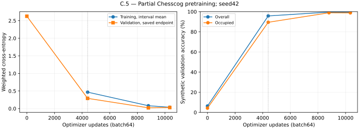

# C.5 — Full Chesscog preparation and bounded Stage 1 pretraining

Started2026-10-26; completed2026-10-27 UTC. **The bounded experiment is complete; eight-epoch pretraining is not.** Two full epochs plus1,549/4,399 batches (35.21%) of a third epoch were processed:10,347 updates/662,208 training-square exposures. The time cap stopped training. No production model is replaced.

## Frozen experiment and authorization

Reviewed C.4's report, actual root `VISION_RESEARCH.md`, configuration, Dataset/preprocessing, training kernel and Modal integration. C.4 artifacts remain unchanged. C.5 adds measurement/recovery wrappers; it does not redesign recognition.

The owner authorized one initial L4 training run with approximately **$2 incremental metered usage**, plus preparation and representative profiling. The owner confirmed $29.99 remaining credit. Public SDK 1.6.2 exposes usage and rates, but not the remaining balance or dashboard spending-cap values; those controls remain unverified and were not changed. Authenticated workspace/environment: `akwasipoku-oforiagyei/main`.

Configuration: `configs/training/chesscog_c5_authorized_v1.json`, derived from the unchanged C.4 plan. MobileNetV3 Small, 1,531,325 parameters; existing 13 classes; 4-channel RGB+mask; `context1_224`/224 pixels; ImageNet normalization; ImageNet RGB initialization and zero mask-channel weights; seed42; batch64; two workers; Adam LR .001; StepLR .9; one head+stem epoch then full unfreezing; unchanged photometric augmentation and validation-loss checkpoint selection. Nominal maxima remain eight epochs and 35,200 updates. **Only the wall-time budget is tightened:** training loop 4,200 seconds, function 5,100 seconds, startup timeout300 seconds. CPU usage is capped at two cores. No hyperparameter/threshold search or additional seed.

Source/data/config fingerprints were registered before training. The complete prepared manifest SHA-256 is `b37bc5922fa4e5d6b7b173e83c1486a3361410fab08bfb6e18fb9889987bfee0`. The checkpoint also carries the runtime-rebased manifest fingerprint, plan hash, architecture/classes, optimizer/scheduler/scaler, RNG, epoch/batch cursor and validation history.

## Complete dataset preparation

| Source role | Official pairs | Eligible boards | Eligible square observations |
|---|---:|---:|---:|
| Training | 4,400 | **4,399** | **281,536** |
| Validation | 146 | **146** | **9,344** |

All 4,546 matched image/JSON pairs decoded and passed FEN/piece-list consistency, finite convex in-image corners, published camera-side convention, 64 canonical labels/mappings and representative B.2 crop/mask checks at four board corners and the centre. No invalid annotations were found. Each image/annotation hash is retained. Full training/validation decoding also applies the existing target-coverage gate on every loaded target.

One training render, **2497**, has the same placement as protected personal validation **position_003** (Sicilian Najdorf). It remains source-role `train` with inclusion `quarantine`; no frozen split was reassigned. No other known cross-role placement/source conflict was found. All eligible training placements are distinct; validation has 146 distinct placements. The minimum 4,000-training-board guard passes unchanged. Game/session identities are not supplied by the synthetic metadata, so unknown underlying game relationships cannot be certified.

All three train/validation archive parts match published **SHA-256** values:

| Part | Bytes | SHA-256 |
|---|---:|---|
| train.z01 | 4,294,967,296 | f133f56059bdf2be5f6a33db4c14d11525c5f8c6dd91c46bf93e2c73dda771f5 |
| train.zip | 2,416,209,370 | f3a13eb4753f5c0d00f6691747efa9e07ef072a82ba5da16e9e668cb346ac7c4 |
| val.zip | 222,952,872 | b26e2747b8016a3fa8ad16e4567e00d9d6237c8e229c445de9b8ea3c761b9f54 |

Every extracted paired member passed CRC/length validation. Total downloaded archives: **6,934,129,538 bytes**. Source images, annotations and archives remain in Modal Volume `chess-vision-c4-data-v1`, directory `/chesscog-c5-v1`. Measured logical preparation storage: **13,909,521,406 bytes (13.91GB)**, including archives, extracted pairs and metadata. Archives are retained as verified preparation caches; continued storage is billed separately over time (roughly $1.17/month for this footprint at the recorded rate), not free forever.

No external Chesscog test archive/image was downloaded or evaluated. No personal photograph/video was used by the Stage 1 model. Only the prepared metadata was streamed locally: 36,762,322 bytes raw, **1,582,242-byte deterministic gzip**, hash-checked and independently grouped-audited. No multi-GB local dataset copy.

Compatibility is the C.4 versioned `b2-annotated-corners-regular-grid-v1` approximation: identical B.2 crop/mask/resize/normalization operators, using the external annotated-corner regular grid rather than historical fitted geometry. The known B.2 tall-piece truncation limitation is not silently changed.

Official source/license: [Chesscog](https://github.com/georg-wolflein/chesscog), [OSF rendered dataset](https://osf.io/xf3ka/), CC BY 4.0 data/MIT code. Attribution: Georg Wölflein and Ognjen Arandjelović, *Dataset of Rendered Chess Game State Images*.

### Preparation interruption and minimal recovery

The existing C.4 preparation action was tried first. Modal preempted its CPU container before archive downloads; the platform replay hit C.4's nonempty-directory guard and stopped. **No model training had occurred.** Modal preemption restarts are distinct from application retries and can happen even with `retries=0` ([official documentation](https://modal.com/docs/guide/preemption)).

C.5's versioned recovery wrapper reused the directory/source utilities, added archive hash verification/recovery and invalid-annotation quarantine, and completed preparation on a bounded non-preemptible CPU worker. This CPU-only setting incurs 3× CPU/memory list rates and is unsupported for GPU functions; it was included in the budget. Preparation took **1,246.02 seconds**. Historical C.4 source files were not edited. The GPU wrapper uses a committed exclusive one-attempt marker, so a platform replay cannot silently start the training again. No training retry or additional model experiment is scheduled.

## Representative throughput and budget decision

Deterministic sample: **128 full-source boards/8,192 squares**, batch64 and the intended Dataset/DataLoader/augmentation/optimizer path, measured in both training modes. Eight batches per mode are excluded as warmup; 7,168 steady-state examples remain. Probe weights are discarded.

| Mode | Steady-state squares/s | Loader wait | GPU-step time | Steady-state wall time |
|---|---:|---:|---:|---:|
| Head+stem | 129.35 | 25.326s | 2.381s | 27.707s |
| Full backbone | 138.15 | 23.181s | 2.762s | 25.943s |

Loader wait is consumer-visible stall after prefetch, not total worker CPU time. GPU utilization averaged **2.35%** over 79 `nvidia-smi` samples; peak torch allocation was **630,182,912 bytes (~601MiB)**, with maximum sampled device memory1,132MiB. The workload is substantially input-bound. No unmeasured acceleration is assumed.

Estimated head+stem epoch: **2,176.5s**; full epoch: **2,037.9s**. A 1,024-square validation sample took14.137s, estimating **129.0s** for all9,344 validation squares. Eight epochs plus validation project to **17,474s (4.85h), ~$4.65** at the requested L4+CPU2+8GiB rate $0.9586/hour, excluding preparation/initialization/storage. Thus eight complete epochs cannot reasonably fit this C.5 allocation.

Before training, the conservative usage delta was checked against aggregate and component billing snapshots (which can lag). The registered upper planning estimate is **$1.70875**, including prior usage, maximum GPU-function/startup time and a $0.10 reserve. Actual collected usage was $1.38; the estimate was not a billing-cap guarantee. No account billing controls were modified. Followed the repository [Modal skill](../../.agents/skills/modal/SKILL.md) and official SDK/documentation; no credentials were printed.

## Training and validation results

Two complete epochs and a partial third were processed. The latest resumable state is zero-based `epoch=2,next_batch=1549,updates=10347`; this is **partial Stage1 training**, not completion of the eight-epoch plan. The pretrained synthetic model remains an experimental initialization for subsequent adaptation.

| Endpoint | Updates | Training loss, interval mean | Validation loss |
|---|---:|---:|---:|
| ImageNet + random13-class head | 0 | — | 2.626180 |
| Epoch1 | 4,399 | 0.467063 | 0.290277 |
| Epoch2 | 8,798 | 0.080750 | 0.021270 |
| Epoch3 (partial) | 10,347 | 0.036808 | 0.029112 |

The training loss is the observed, class-weighted cross-entropy aggregated by its weight denominator across that interval. Validation uses the same training-derived class weights. The observer returns the original loss unchanged; a focused test verifies identical loss and gradients. No inference threshold or hyperparameter was tuned from these outcomes.



| Model | Overall | Occupied | Empty false positives | Occupied→empty | Wrong piece identity | Exact boards |
|---|---:|---:|---:|---:|---:|---:|
| Seed-matched ImageNet initialization | 6.34% | 4.24% | See raw reference | See raw reference | See raw reference | 0/146 |
| Validation-selected best, epoch2 | 99.59% | 98.91% | 3/6,137 (0.0489%) | 11/3,207 | 24 | 111/146 (76.03%) |
| Latest, partial epoch3 | 99.50% | 98.82% | 9/6,137 (0.1467%) | 8/3,207 | 30 | 104/146 (71.23%) |

The registered minimum-validation-loss rule selects the **epoch2 checkpoint**, not the latest state. Additional updates reduced training loss but slightly worsened validation loss/accuracy and reduced exact boards from111 to104. This is not enough evidence to diagnose overfitting definitively, but it supports retaining the selected best rather than assuming that more updates are better.

### Per-class performance of the selected best

| Class | Validation support | Precision | Recall |
|---|---:|---:|---:|
| empty | 6137 | 99.82% | 99.95% |
| white_pawn | 828 | 99.03% | 99.03% |
| white_knight | 158 | 96.93% | 100.00% |
| white_bishop | 163 | 99.38% | 98.77% |
| white_rook | 221 | 100.00% | 100.00% |
| white_queen | 91 | 97.73% | 94.51% |
| white_king | 146 | 97.32% | 99.32% |
| black_pawn | 822 | 99.75% | 98.54% |
| black_knight | 147 | 100.00% | 99.32% |
| black_bishop | 176 | 99.44% | 100.00% |
| black_rook | 219 | 100.00% | 97.72% |
| black_queen | 90 | 96.77% | 100.00% |
| black_king | 146 | 99.32% | 99.32% |

[Full best/latest per-class table](chesscog_c5_class_performance_v1.csv); complete confusion matrices, per-board/per-position and camera-side breakdowns are preserved in the result/validation artifacts. White-queen recall is lowest (86/91). Frequent residual confusions include black pawn→white pawn(6), black pawn→empty(6), white pawn→white knight(5), and white queen→white king(4). King→rook errors are0 on this synthetic validation set; **the physical C.1 king/rook failure is not established as solved**. Crop truncation, occlusion or annotation error cannot be assigned as the cause of these individual residual errors from the confusion matrix alone.

The selected best has38 wrong squares:11 occupied-to-empty misses,24 incorrect occupied identities and3 empty false positives. **Twelve errors have raw maximum probability≥0.9, including two empty-square false positives**. These probabilities are uncalibrated; no B.4 calibration or automatic completion gate is applied.

### Runtime and resource measurements

| Measurement | Actual |
|---|---:|
| Train/validation/checkpoint kernel | 4,275.81s /71.26min |
| Timed initial-validation + kernel + final-evaluation region | 4,550.41s /75.84min |
| Billed L4 allocation inferred from collected GPU cost/rate | 4,574.02s /76.23min |
| Recorded optimizer-batch compute region | 593.76s |
| Checkpoint write + Volume commit total | 217.44s |
| Peak torch GPU allocation | 628,982,784 bytes (~599.84MiB) |
| Mean sampled GPU utilization | 4.31%,303 samples |
| Maximum sampled device memory | 995MiB |

The 4,200-second limit is checked at optimizer boundaries; final validation/save/reload add time after the loop stops. The complete function remained below5,100 seconds. Setup, allocation, and billing durations are distinguished from the timed region. Input preparation remains the main efficiency limitation; the measurements do not isolate CPU crop/augmentation time from filesystem latency. No full-host peak RAM measurement is claimed.

## Checkpoints and reproducibility

Both checkpoints are isolated in `chess-vision-c4-artifacts-v1:/chesscog-c5-seed42-v1/` and exported locally:

- `outputs/evaluation/chesscog_c5/checkpoints/chesscog_best.pt` — 18,647,267 bytes; SHA-256 `11c54e55cd77ffa9fd8530dc75283a5d77953bbb66f0018b8a1f9deca049f1c9`.
- `outputs/evaluation/chesscog_c5/checkpoints/last.pt` — 18,617,293 bytes; SHA-256 `affbb32fd7c1bd55ff347725deecf376c5b73d6d2b114229e44794d2efcc4bf4`.

Use **last.pt for continuation** (epoch2/cursor1549); use **chesscog_best.pt for future transfer** (selected at8,798 updates). Best and latest contain different model tensors. Optimizer, scheduler, scaler and Python/NumPy/Torch RNG state are present; latest LR is0.00081. No continuation was launched.

Both models reproduced their saved full-validation confusion matrices after remote reload. Exported bytes match the remote hashes. Strict CPU reload in the local application environment succeeded with finite1×13 outputs on an arbitrary zero-input compatibility check, not an accuracy evaluation.

Canonical plan hash: `4643d876a26dcc9e921fda8acbbfb794c6efecfb681a6b2a6912b506cb70d48f`. Runtime-rebased manifest fingerprint: `96b789f6278033ad6b27906176023791abf2c59f79579954e6d41fad2c618556`. The raw source-manifest hash is recorded above; the difference is expected because runtime image paths are rebased to the Volume mount. `executed_source_fingerprints_v1.json`, the authorized configuration, complete compact history, validation logits for all13 classes, and checkpoint contracts are preserved.

## Actual spending and remaining credits

Collected per-resource costs, including the failed initial CPU preparation attempt:

| Work | USD |
|---|---:|
| Preempted C4 preparation attempt | 0.00017627 |
| Completed non-preemptible preparation | 0.13314743 |
| Representative L4 profiling | 0.02982304 |
| Single L4 training + validation run | 1.21835402 |
| **Total collected resources** | **1.38150076** |

The settled aggregate metered increase is **$1.38084862**, and the conservative component delta is **$1.38150080**. Minor differences reflect aggregation/rounding; raw snapshots and hourly resource rows are preserved. The earlier provisional aggregate was higher and subsequently reconciled downward. The **approximately $2 target was met**; $0 is billed after credits/allowances in the current snapshot. This is collected usage, not a promise of the final invoice; continuing Volume storage may accrue.

Credit adjustments increased by **$1.38**. Subtracting that from the owner's confirmed starting $29.99 gives **approximately $28.61 remaining**, not an independently verified live balance. No spending-control setting was changed. All C.5 Apps are stopped with zero tasks; no paid GPU job remains running.

## ChessReD access investigation

The official 4TU metadata, file-list and annotation endpoints still time out from this environment. DNS resolves `data.4tu.nl` to `131.180.169.22`, but a bounded TCP connection to port443 timed out before TLS/HTTP. This is a transport-access blocker, not an observed annotation-parser failure; the precise cause (host availability or network path) cannot be established here. The browser fetch independently timed out. Official GitHub/code and the DOI registry remain accessible.

The official repository has no release assets. Its [maintainer response to an earlier download failure](https://github.com/tmasouris/end-to-end-chess-recognition/issues/1#issuecomment-1898603739) attributes that historical failure to hosting and points back to 4TU; this is not proof of the current outage's cause. No supported equivalent raw-dataset mirror was identified. The official README's Google Drive **preprocessed1024px** image archive is an alternative released input, but does not resolve missing annotation/geometry access or establish B.2-native parity. It was not downloaded.

Annotations are already offered separately from the large image archive in the [official configuration](https://github.com/tmasouris/end-to-end-chess-recognition/blob/main/cfg/chessred.yaml). The [paper](https://www.scitepress.org/publishedPapers/2024/123702/pdf/index.html) documents corners/bounding boxes only for **ChessReD2K:2,078 images from20 games**, with14 training games/1,442 images,3 validation/330 and3 test/306. These are documented counts, not newly verified usable images. The complete10,800-image release must not be assumed geometry-covered.

Official Dataset code confirms `images[].path`, `annotations.pieces`, categories, canonical a8→h1 square indexing, and `splits[role].image_ids/n_samples`. Actual annotation bytes remain unavailable, so corner-record layout, semantic corner identities, game-ID extraction and the current C.4 conversion boundary cannot be certified against the artifact. No third-party copy was substituted; no ChessReD training was run.

Smallest practical Stage2 step: obtain and hash-check **annotations.json only** from the official URL (published MD5 `d34bca5ad46ec7a8df96a1d3c36784f3`), inspect its actual corners/game/split tables, and convert only verified ChessReD2K train/validation records. Then retrieve just those official image files, using supported archive ranges if available or an author-supported subset package. This is a readiness task, not authorization to train Stage2.

## Reproduction and artifacts

```bash
# Existing C4 attempt (preempted; guarded restart stopped)
.venv/bin/python -m modal run scripts/modal_multidataset_c4.py --action prepare-chesscog --authorize-full-download --bundle chesscog-c5-v1 --run-id chesscog-c5-prepare-v1
# Versioned recovery and completed preparation
.venv/bin/python -m modal run scripts/modal_chesscog_c5.py --action prepare-chesscog
# Single representative throughput test; weights discarded
.venv/bin/python -m modal run scripts/modal_chesscog_c5.py --action profile
# The one authorized bounded run
.venv/bin/python -m modal run scripts/modal_chesscog_c5.py --action train
```

Fresh-output/one-attempt guards intentionally reject rerunning these exact paths. Do not replay training without new authorization. Record files, logs, compact manifest and profiling results are under `outputs/evaluation/chesscog_c5/`. All checkpoints will remain isolated in Modal Volume `chess-vision-c4-artifacts-v1`, `/chesscog-c5-seed42-v1/`, and ignored local exports. No production checkpoint is overwritten.

## Verification status

**253 relevant Python regressions and39 browser tests passed** after completion. Both checkpoint exports/reloads passed; all5,287 protected historical hashes still match after training, including C.4. The executed source/configuration fingerprints remain unchanged. This is the relevant regression group, not a claim that every repository test was run.

Focused C.5 tests cover published archive hash verification, annotation quarantine, unchanged official roles, rejection of external-test downloads, one-attempt claims, conservative cost accounting and identical loss/gradients with observation enabled. Existing C.4 tests cover masks/mappings, grouped leakage, authorization/transfer contracts and interrupted CPU replay. Original videos, historical reports/predictions/checkpoints and production inference remain unchanged. No final holdout access; no commits/pushes.

## Files added and acceptance checklist

- `src/training/chesscog_c5.py`: versioned preparation recovery, measurements and validation helpers; C.4 training/model/preprocessing source unchanged.
- `scripts/modal_chesscog_c5.py`, `export_chesscog_c5_metadata.py`, `export_chesscog_c5_checkpoints.py`, `report_chesscog_c5.py`; `tests/test_chesscog_c5.py`.
- `configs/training/chesscog_c5_authorized_v1.json` and versioned C.5 authorization/dataset/results/index metadata.
- This report, standalone learning-curve SVG and per-class CSV. Ignored `outputs/evaluation/chesscog_c5/` contains logs, source plan, compact manifest, billing snapshots, result artifacts and exported checkpoints. No large binary dataset/model file is added to Git.

- [x] Full official train/validation preparation; published hashes/member CRCs; all pairs decoded/label-checked; minimum guard unchanged.
- [x] One protected-position overlap quarantined; source roles/grouping preserved; test archive excluded.
- [x] Representative batch64 throughput, input stalls, GPU memory/utilization and cost estimates measured before training.
- [x] One authorized bounded initial Stage1 run; no automatic training retries/extra seeds/Stage2/Stage3.
- [x] **Partial completion explicit:** two full epochs +35.21% of third,10,347 updates, not eight epochs.
- [x] Full eligible synthetic-validation scoring, per-class/confusion/board metrics and compact learning curves.
- [x] Best/latest persistent checkpoints exported; hashes, dataset/config association and reload verified.
- [x] Actual collected cost~$1.38 within target; balance provenance/unknown spending controls/continuing storage documented.
- [x] ChessReD access blocker investigated; no fabricated schema verification, third-party substitution or blind full download.
- [x] Relevant regressions and historical preservation passed; no production/holdout/original-media changes or commit/push.

## Recommendation and stopping decision

**Retain the validation-selected epoch2 checkpoint as the partial Stage1 candidate.** It learned the synthetic task meaningfully, but further updates in this run did not improve validation. There is no basis to replace B.2 or claim improved recognition on the owner's physical board; no such evaluation was performed, and synthetic squares are not independent physical sessions. This remains one seed/one official synthetic split, with shared rendering assets and unknown underlying game relationships.

The next task should be **Stage2 data readiness: obtain the official annotation-only artifact, verify the actual ChessReD2K geometry/semantic/game schema and grouped exclusions, and retrieve only eligible train/validation images**. Audit repeated opening placements against the existing strict grouping rules rather than weakening them implicitly. If longer training is later authorized, first consider the measured input bottleneck and reuse the resumable checkpoint; do not rerun preparation or assume all eight epochs are necessary solely because they were the initial maximum.

Stop after C.5. No continuation, adaptation, personal fine-tuning or production promotion is authorized by this report.
