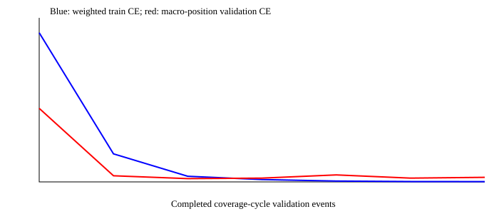

# C.9 — Expanded real-world data and ConvNeXt V2 Tiny

## Status

Dataset construction, human review, connected splits, pretrained-weight verification, the L4 feasibility test and the bounded training campaign are complete. Training reached its registered early-stopping rule after **seven coverage cycles / 3,682 updates**; the minimum-validation-loss checkpoint is **update1,578**. Twelve cycles were a maximum, not completed. Both checkpoints were exported and hash-verified. The matched CPU validation and once-only retrospective internal test are complete. No convergence or independent-generalization claim is made.

This is offline research, separate from the assisted MVP. No production inference, geometry, browser workflow or checkpoint has been replaced. No separately protected final holdout was accessed.

## Data inventory and human verification

All **180 original photographs and 15 original-quality video recordings** are present and match their historical hashes. Source paths, native media metadata, existing FENs and historical eligibility are recorded in `outputs/evaluation/convnext_c9/inventory_v1.json`. The compact [source inventory](convnext_c9_sources_v1.csv) records every original photo and every accepted video frame. `data/metadata/convnext_c9_data_use_v1.json` records the explicit C.9-only change in authorization. Historical splits/results remain unchanged; reused material is not independent evaluation evidence for this model.

The historical prepared dataset admitted 160 photographs. All 20 remaining originals had failed legacy checkerboard localization. Unchanged opt-in B.1b recovery produced reviewable geometry for 19; the owner verified their FEN agreement, unchanged arrangement, semantic orientation, true corners, canonical mapping, crop alignment and all target masks. **`position_005_var_03.jpg` remains quarantined**: localization failed and marked-board recovery rejected `grid_refinement_excessive_shift`. No missing geometry or labels were manufactured.

The final dataset contains **179 photos + 184 video frames = 363 board views**, representing **29 canonical piece placements in 25 connected groups**. The review packet contains **19 recovered photos and 125 new video views**, all covered by the owner's explicit all-seven-check confirmation; approval is bound to packet/source/geometry hashes in `data/metadata/convnext_c9_reviews_v1.json`. Earlier question/design prose misstated the category counts as 20/124 and 180/183; this documentation error does not change the frozen manifest, review identities or training inputs. The original design includes an explicit erratum.

Existing D.2 and C.4 video reviews were replayed rather than requested again. The corrected A.3 middlegame c7 black pawn uses the existing separately versioned, owner-confirmed label supplement; original FENs and original-label historical results remain preserved. The known A.3 endgame-at-0s h4 alignment ambiguity remains labeled ambiguous and excluded, not relabeled. The other 63 squares in that view remain usable. Hard/occluded examples retain their intended labels when alignment is reviewed; review does not establish every piece silhouette is fully visible or geometry is pixel-perfect.

### Video diversity and selection

Selective timestamp decoding uses existing presentation-timestamp indexes and the source rotation metadata. It does not create video transcodes or a full persistent frame dump. The C.9 adapter normalizes the A.3 index's historical display-rotation convention using its encoded rotation; a regression verifies exact reviewed decoded pixels. Original indexes are unchanged.

The one-second temporal candidate set contains **1,078 candidates**, with **749 quality-eligible candidates** under unchanged geometry/orientation rules. Reviewed historical and new candidates are jointly filtered using temporal spacing and the existing appearance/viewpoint proxy. **83 proxy-redundant reviewed views are excluded**, leaving 184. This is proxy diversity, not proof that recognition information is losslessly preserved. The requested 20–40/session target was investigated rather than forced; only 8–16/session survive the conservative quality/review/redundancy conditions. A fixed quota is not used to lower verification standards.

| Recording | Accepted frames |
|---|---:|
| A.3 starting / opening / middlegame / endgame / puzzle | 12 / 13 / 16 / 8 / 10 |
| D.3c 01 / 03 / 05 / 07 / 09 | 12 / 15 / 16 / 10 / 10 |
| D.3c 11 / 13 / 15 / 17 / 19 | 15 / 10 / 12 / 11 / 14 |

Each frame retains source-video hash, session, placement, timestamp, original frame identity, semantic orientation, geometry provenance, reviewed masks and labels. Native metadata and selection reasons remain in the inventory/candidate/review records. Camera-side classifications and image-space perspective proxies are not precise calibrated poses. The nighttime video domain and single physical chess set remain limitations.

## Frozen connected split

Placement keys use only canonical piece placement, ignoring FEN counters/turn. Connected components also join source identity, session, declared capture cohorts and known duplicate relationships. No random square/frame split is used. Exact overlaps include A.3 starting/photo001, A.3 endgame/photo013, A.3 puzzle/photo017 and D.3c03/photo003. Their entire components stay together. The shared A.3 capture-cohort identifier conservatively joins all five pilot positions into training; no A.3 frames occur in validation or internal testing.

| Partition | Positions | Board views | Photos | A.3 video | D.3c video | Eligible squares |
|---|---:|---:|---:|---:|---:|---:|
| Train | 21 | 263 | 139 | 59 | 65 | 16,831 |
| Validation | 4 | 41 | 20 | 0 | 21 | 2,624 |
| Internal retrospective test | 4 | 59 | 20 | 0 | 39 | 3,776 |

Positions are 72.4%/13.8%/13.8%; views need not match those ratios. Validation: photo004/photo018/D.3c13/D.3c17. Test: photo003+D.3c03/photo014/D.3c09/D.3c19. Complete assignment, class/source distributions and grouping decisions are in `data/metadata/convnext_c9_split_v2.json` and `outputs/evaluation/convnext_c9/data_summary_v1.json`.

Split v1 was superseded **before fitting** because label-only coverage checks found insufficient rare-class position coverage. Frozen v2 requires rare occupied classes in at least two validation/test placements. No model predictions influenced the split. Unknown original-photo capture sessions remain unknown; connected placement grouping avoids claiming undocumented independence.

Internal testing is **retrospective**, because these positions have been inspected during earlier development. It remains excluded from this run's training, checkpoint selection, early stopping and tuning. `C9Squares` rejects opening it without an explicit evaluation flag; the remote evaluator creates a selected-checkpoint/configuration lock and exclusive one-test-event marker first. No test result may trigger retraining within this task.

An exact board means all64 canonical **piece-placement classes** are correct in that view. Side to move, castling, en passant and move counters are not inferred by this classifier.

## Model, preprocessing and licenses

Architecture: `timm==1.0.22`, **`convnextv2_tiny.fcmae_ft_in22k_in1k`**, 27,878,029 parameters after adaptation. The [official model card](https://huggingface.co/timm/convnextv2_tiny.fcmae_ft_in22k_in1k) documents the FCMAE/ImageNet-1k and ImageNet-22k→1k training lineage. Upstream config/model card/code/license receipts are preserved in `outputs/evaluation/convnext_c9/upstream_v1/`.

| Artifact | Value |
|---|---|
| Official revision | `b1dd46230e80bf4cc3fa0c3c905db2c3ec53a817` |
| Safetensors bytes | 114,561,694 |
| Official checkpoint SHA-256 | `6652fd90fc9c23977659e58515778e16fbbcd43f0b01fc693089cebe6d64c2a9` |
| Frozen C.9 manifest SHA-256 | `680330c84d10da74bbba94b6f30c0d419102a1adad74b9f329004f976a19ca9d` |
| Frozen B.2 reference SHA-256 | `dad8eea28482ee894dfca0794d9f4415d21ac58db23c6d6bed8c4307c71b1bd8` |

The [weights](https://huggingface.co/timm/convnextv2_tiny.fcmae_ft_in22k_in1k/blob/main/README.md) are **CC BY-NC 4.0**. This run is noncommercial research; commercial deployment rights are not assumed. Timm code is Apache 2.0; upstream Meta reference code is MIT. Licensing is a separate deployment constraint even if accuracy improves. No backbone or pretrained checkpoint was silently substituted.

The 96×3×4×4 pretrained RGB stem is copied into a four-channel stem; the mask weights initialize to zero, preserving RGB-only behavior at initialization. The head becomes 13 classes in the unchanged order: empty, white pawn/knight/bishop/rook/queen/king, black pawn/knight/bishop/rook/queen/king. Strict loading/hash/shape checks reject wrong weights or class contracts.

The inherited B.2 `context1_224` packer remains unchanged: RGB plus binary target indicator, one-square context padding, 224×224 AREA RGB resizing and NEAREST mask resizing, RGB scaled to [0,1] then ImageNet mean/std normalization, unnormalized binary mask. Existing packed-input hashes bind reviewed pixels/masks. No taller crop or official 288px/bicubic/center-crop transform is added. ConvNeXt's stride-4 stem is an architecture difference. Extra capacity cannot restore visual features already truncated by B.2 crops.

## Training contract and source exposure

`configs/training/convnext_c9_authorized_v1.json` was frozen before training. One seed42 campaign, ImageNet initialization (not Chesscog/C.7), batch32, BF16, two workers, two bounded CPU cores, L4 and 8GiB system memory. Twelve nominal coverage cycles: first head+stem, then full fine-tuning; AdamW weight decay .05, no decay for bias/one-dimensional parameters, clipping1. Head phase stem LR1e-4/head1e-3; full phase backbone3e-5/stem1e-4/head3e-4, cosine down to10%. Existing C.4 mild brightness/contrast/blur/noise augmentation leaves masks aligned.

Every eligible photo and video observation is visited per coverage cycle. Complete photo passes would repeat if video views exceeded photo views; here 139 photo/124 video boards require one pass each. Position-weighted losses and class weights derived from unique train placements reduce domination by correlated video views. Position factors are not canceled through a per-batch denominator. Source/frame/class exposures are checkpointed explicitly. Twelve full cycles would draw 106,752 photo-square and 95,220 video-square exposures across 21 train positions (6,312 optimizer updates). Actual exposure must be read from the final run receipt rather than assumed from the nominal plan.

Select minimum macro-physical-position class-weighted validation CE, patience4 in the full phase. Limits: 20,000 updates, 9,000s training loop, 10,800s function plus 300s startup. Best and resumable-last are separate; last includes optimizer, scheduler cursor, RNG, loss accumulators, source/frame/class exposures and dataset/config fingerprints. A CPU interrupted-run regression verifies exact resumed state behavior. Completing a fixed schedule does not establish convergence.

## L4 feasibility, budget and interruption

The completed one-use smoke test verifies pretrained loading, 4-channel zero-mask invariance, 13 outputs, finite loss, gradients, forward/backward, checkpoint reload and separate CPU-container persistence. Updated smoke weights are discarded before full training.

| Measurement | Observed |
|---|---:|
| Head+stem steady throughput | 88.49 squares/s |
| Full-backbone steady throughput | 117.32 squares/s |
| Validation sample throughput | 62.08 squares/s |
| Peak torch GPU allocation | 4,017,812,480 bytes |
| L4 reported memory | 23,689,363,456 bytes |
| Smoke region duration | 78.46s |

Each phase measures 64 batches, excluding eight warmups. Recorded loader wait is consumer stall, not total preprocessing CPU work. Full schedule throughput extrapolates to 2,275.58s before a35% margin. Initial estimated cumulative usage was $1.47 with allowances, below the authorized $5. Requested L4+CPU2+8GiB rate is $0.9586/hour in saved rate receipts. Script timeouts are not account spending caps; remaining credits and dashboard limits are not available from the read-only API and were not modified.

The original job stopped on a local `StreamTerminatedError: Connection lost`, at least through update200. Remote last-checkpoint retrieval initially produced a same-length corrupt local copy; a fresh transfer strict-loaded successfully. Verified SHA-256: `f0a20d437932b115452ec595e6440eb967db213f3e90ca82559e424218541ae2`, epoch0/next_batch200, history empty, optimizer/scheduler/RNG intact, unchanged parent/config/dataset. No validation-selected best or internal-test event existed at that point. The bad local transfer is not evidence of an invalid remote checkpoint.

The owner then instructed continuation. A new explicit one-use continuation claim verifies the exact checkpoint and blocks after selection/test. The original trainer/schedule/config remains unchanged. The continuation uses `modal run --detach`, and no additional seed/variant/fresh initialization is launched. As of submission, prior C.9 metered resources total **$0.08145249**; the remaining requested function-resource planning bound is **$3.05568**, conservatively below the cumulative $5 limit. These are a usage snapshot and planning bound, not a finalized invoice. The submitted app is `ap-mflRSRz7RoXEMhuajLxGC4`; initial progress is delayed by Modal's reported L4 scheduling-capacity shortage.

## Storage and reproducibility

### Final training receipt and evaluation recovery

The L4 continuation ran for **1,174.76s** after restoring update200, including841.22s measured training compute and85.81s periodic checkpoint writes. Peak torch allocation was4,015,064,064 bytes. The latest checkpoint reload produced exactly matching logits (max difference0). There are seven complete training/validation history events. Source exposures total **62,272 photo squares +29,120 D.3c squares +26,425 A.3 squares =117,817**, covering every eligible train board seven times. No photo exposure was replaced by video exposure.

Best validation loss occurred at zero-based epoch2/update1,578 (.0106700). Four subsequent full-phase validation checks did not improve it, triggering the registered patience4 rule at epoch6/update3,682. `partial_training=true` in the kernel receipt means seven is less than the nominal12-cycle maximum; the **early-stop criterion was completed**, and no continuation through the remaining five cycles is scheduled. This is not a claim of convergence.

The remote worker committed `training_result.json`, hash/reload results and `selection_lock.json` before its client failed with `AuthError: Jwt is expired`. A cancellation signal arrived before final comparison/test output. Read-only post-stop inventory confirms there was **no remote internal-test marker or prediction file**. No additional training was launched. `scripts/finalize_convnext_c9_cpu.py` verifies the pre-existing selected hash/config/data lock, creates a one-use local test marker and evaluates both models using the same CPU FP32/batch32/threads2 backend. GPU training-validation metrics and final CPU comparison metrics are preserved separately; CPU results do not reselect weights.

Best export: `outputs/evaluation/convnext_c9/export_v1/convnextv2_tiny_best.pt`,111,605,349 bytes, SHA-256 `45b471edb751261e9da1ef8703f3d9c940cdaec69f5713f6847e48bf0dc26acb`.

Resumable last: `outputs/evaluation/convnext_c9/export_v1/last.pt`,334,769,283 bytes, SHA-256 `c27028fdeef8d834618ebd2f13cc25440f7c7fdb95aed3c45f7a34b6470f3c36`. Local verification confirms epoch7/next_batch0, optimizer/scheduler/RNG preserved, bad_epochs4. The initial interrupted update200 checkpoint is also preserved. No automatic restart or extra experiment follows C.9.

The collected C.9 app-resource ledger is **$0.40471369** ($0.32326120 for the continuation, $0.04899499 for the original interrupted invocation, $0.02609856 smoke, plus preparation/recovery). This is a metered-compute snapshot, not a finalized invoice or verified remaining credit balance; ongoing Volume storage and later export/egress accounting are separate. All cloud apps are stopped. CPU final evaluation adds no Modal GPU cost.

After verification, the corrupt local checkpoint transfer and redundant local transfer archive were removed, freeing518,073,794 bytes. Their hashes/reasons remain in `temporary_cleanup_v1.json`; the valid update200 checkpoint, selected/latest checkpoints, remote prepared data and transfer receipts remain. No original media or protected artifact was removed.

## C.9 files and implementation boundaries

- `src/training/convnext_c9.py`, `dataset_c9.py`, `trainer_c9.py`, `evaluation_c9.py`, `resume_c9.py`, `transfer_c9.py`: isolated architecture, B.2-compatible Dataset, grouped coverage, training/checkpoints, fixed metrics and safe transfer/resume gates.
- `scripts/prepare_convnext_c9.py`, `review_convnext_c9.py`, `split_convnext_c9.py`, `materialize_convnext_c9.py`, `package_convnext_c9.py`, `summarize_convnext_c9_data.py`: source inventory, reviewed candidate extraction, grouped split, context cache, transfer and data distributions.
- `scripts/modal_convnext_c9.py`, `export_convnext_c9.py`, `finalize_convnext_c9_cpu.py`: bounded Modal execution, checksum exports and locked post-training CPU evaluation.
- `scripts/report_convnext_c9.py`, `benchmark_convnext_c9.py`, `finalize_convnext_c9_report.py`, `check_convnext_c9_integrity.py`: saved-logit diagnostics, CPU timing, result tables/index and historical/media preservation.
- `configs/training/convnext_c9_authorized_v1.json`, `data/metadata/convnext_c9_*.json`, `tests/test_convnext_c9.py`, this report/design, source/class CSVs and learning-curve SVG: versioned contract, review/provenance/split/results and focused regressions.

No production source or historical training contract was changed. Generated media/caches/checkpoints remain under ignored `outputs/`; no original recording was copied to Git or Modal.

Original recordings are never uploaded or duplicated. A 406,328,575-byte checksum-bound transfer archive contains only compact derived contexts/masks, metadata and the B.2 comparison checkpoint. Existing C.7 contexts are reused in the data Volume; extraction verifies 706 referenced files. New extracted transfer contents use 445,660,330 logical bytes. Pretrained weights remain remote; generated caches/checkpoints are outside Git. Volumes: `chess-vision-c4-data-v1`, `chess-vision-c4-artifacts-v1`; run directory `/convnext-c9-seed42-v1/`.

```bash
# Source inventory/candidates/review must precede frozen manifest packaging.
# Existing v1 outputs are intentionally immutable; do not rerun to overwrite them.
.venv/bin/python scripts/prepare_convnext_c9.py inventory
.venv/bin/python scripts/prepare_convnext_c9.py candidates --workers 2 --interval-ms 1000
.venv/bin/python scripts/review_convnext_c9.py photos
.venv/bin/python scripts/review_convnext_c9.py packet
.venv/bin/python scripts/split_convnext_c9.py
.venv/bin/python scripts/materialize_convnext_c9.py
.venv/bin/python scripts/materialize_convnext_c9.py --reviews data/metadata/convnext_c9_reviews_v1.json
.venv/bin/python scripts/package_convnext_c9.py
# First-run preparation (already completed):
.venv/bin/python -m modal run scripts/modal_convnext_c9.py --action prepare-weights
.venv/bin/python -m modal run scripts/modal_convnext_c9.py --action upload
.venv/bin/python -m modal run scripts/modal_convnext_c9.py --action prepare-data
.venv/bin/python -m modal run scripts/modal_convnext_c9.py --action smoke
# Initial campaign (already claimed; do NOT repeat):
.venv/bin/python -m modal run --detach scripts/modal_convnext_c9.py --action train
# Authorized exact-checkpoint continuation (already submitted; do NOT repeat):
.venv/bin/python -m modal run --detach scripts/modal_convnext_c9.py --action continue-authorized
# After final receipt exists; this starts no compute:
.venv/bin/python scripts/export_convnext_c9.py --training-only
outputs/evaluation/chessqueries_c2_env/bin/python scripts/finalize_convnext_c9_cpu.py
outputs/evaluation/chessqueries_c2_env/bin/python scripts/report_convnext_c9.py
outputs/evaluation/chessqueries_c2_env/bin/python scripts/diagnose_convnext_c9_edges.py
outputs/evaluation/chessqueries_c2_env/bin/python scripts/benchmark_convnext_c9.py --model b2
outputs/evaluation/chessqueries_c2_env/bin/python scripts/benchmark_convnext_c9.py --model convnext
.venv/bin/python scripts/check_convnext_c9_integrity.py --output outputs/evaluation/convnext_c9/integrity_final_v1.json
```

## Validation and preservation

Focused tests: **19 passed**, including real ConvNeXt stem/mask/output/gradient behavior, class and profile gates, authorized exact resume, optimizer/RNG replay, coordinate labels, grouped leakage, rotation replay, source exposure, internal-test gates, exact pre-existing checkpoint selection, aligned comparisons, cost limits and safe archive extraction. The final relevant regression run passed **263 tests** (`python_regressions_release_v1.txt`). Browser regressions passed3/3. No application dependency upgrades were required; CPU model checks use the existing optional C.2 environment.

`integrity_precompletion_v1.json`: **5,517 historical files and 195 original media hashes checked, zero mismatches**. Historical B.2/C.5/C.7 checkpoints, reports, manifests and original videos remain unchanged. No final-holdout paths were opened. No commit or push has been made.

## Acceptance checklist

- [x] Inventory all180 photos and15 original recordings; hash/provenance retained.
- [x] Quarantine unresolved geometry; obtain explicit approval for new training candidates.
- [x] Freeze connected position/session split before training; preserve old splits.
- [x] Verify official pretrained weights, license, zero-mask stem and class/preprocessing parity.
- [x] Complete bounded L4 feasibility and durable checkpoint verification.
- [x] Preserve interrupted state and submit the authorized same-campaign continuation.
- [x] Export final training/checkpoint/history receipts and record measured usage.
- [x] Freeze selected model and complete the once-only retrospective internal test.
- [x] Report matched B.2 comparisons with historical exposure caveats, correction burden, confidence and examples.
- [x] Verify final preservation and stop without production promotion.

Only four physical positions occur in each evaluation partition. Frames/squares are correlated, old positions have prior development exposure, and the B.2 reference may have trained on some new validation/test placements. Even an improvement here would support further validation, not a broad generalization or commercial-deployment claim. The recommendation below uses the fixed model and completed retrospective results.

## Final matched results (CPU FP32)

Both architectures use the same frozen square inputs, labels and ordering, batch32 and two CPU threads. Internal testing ran once after the remote selection lock; no test outcome changed weights, thresholds, eligibility or configuration. The selected validation confusion counts match the saved GPU epoch2 results. Figures count board **views**, not independent sessions/positions.

| Partition/model | Overall | Occupied | Empty FP / empty support | Occupied→empty | Wrong identity | Exact board views |
|---|---:|---:|---:|---:|---:|---:|
| val/b2 | 87.00% | 80.29% | 177/1792 (9.88%) | 3 | 161 | 16/41 |
| val/convnext | 99.35% | 99.28% | 11/1792 (0.61%) | 1 | 5 | 33/41 |
| internal_test/b2 | 79.00% | 72.09% | 433/2486 (17.42%) | 8 | 352 | 11/59 |
| internal_test/convnext | 99.18% | 99.22% | 21/2486 (0.84%) | 0 | 10 | 41/59 |

### B.2 training-exposure strata

B.2 previously trained on all20 new validation photos and10 internal-test photos. Its “unseen” stratum means unseen **training placement**, not never inspected during earlier development. ConvNeXt sees no new validation/test placement in its C.9 training partition. This is not a clean architecture-only experiment: training data, optimization and model capacity all differ.

| Partition/stratum/model | Occupied | Overall | Exact views | Empty FP |
|---|---:|---:|---:|---:|
| val/unseen_by_B2_training_placement/b2 | 63.12% | 75.07% | 0/21 | 172 |
| val/unseen_by_B2_training_placement/convnext | 99.32% | 99.26% | 17/21 | 7 |
| val/exposed_B2_training_placement/b2 | 99.74% | 99.53% | 16/20 | 5 |
| val/exposed_B2_training_placement/convnext | 99.23% | 99.45% | 16/20 | 4 |
| internal_test/unseen_by_B2_training_placement/b2 | 70.17% | 74.78% | 2/49 | 433 |
| internal_test/unseen_by_B2_training_placement/convnext | 99.58% | 99.27% | 36/49 | 18 |
| internal_test/exposed_B2_training_placement/b2 | 97.78% | 99.69% | 9/10 | 0 |
| internal_test/exposed_B2_training_placement/convnext | 94.44% | 98.75% | 5/10 | 3 |

### Physical-position results

Each row represents one canonical physical placement. Multiple photos/video views remain correlated. Only four positions occur in each partition; no significance test or broad generalization claim is justified.

| Partition/position source IDs | Views | B.2 occupied | ConvNeXt occupied | B.2 exact | ConvNeXt exact | ConvNeXt worst errors/view |
|---|---:|---:|---:|---:|---:|---:|
| val/position_004 | 10 | 99.69% | 100.00% | 7 | 9 | 1 |
| val/position_018 | 10 | 100.00% | 95.71% | 9 | 7 | 4 |
| val/d3c_position_17 | 11 | 62.12% | 99.24% | 0 | 9 | 2 |
| val/d3c_position_13 | 10 | 63.55% | 99.35% | 0 | 8 | 6 |
| internal_test/position_014 | 10 | 97.78% | 94.44% | 9 | 5 | 3 |
| internal_test/d3c_position_03, position_003 | 25 | 77.20% | 99.33% | 2 | 19 | 4 |
| internal_test/d3c_position_19 | 14 | 52.86% | 100.00% | 0 | 8 | 3 |
| internal_test/d3c_position_09 | 10 | 60.97% | 100.00% | 0 | 9 | 1 |

### Correction burden and paired changes

| Partition/model | Mean errors/view | Median | 0 corrections | 1 | 2 | 3–5 | >5 |
|---|---:|---:|---:|---:|---:|---:|---:|
| val/b2 | 8.317 | 3 | 16 | 4 | 0 | 3 | 18 |
| val/convnext | 0.415 | 0 | 33 | 5 | 1 | 1 | 1 |
| internal_test/b2 | 13.441 | 10 | 11 | 2 | 6 | 5 | 35 |
| internal_test/convnext | 0.525 | 0 | 41 | 9 | 6 | 3 | 0 |

val: ConvNeXt corrects **333** B.2 errors and introduces **9** errors on previously correct squares; **8** squares remain wrong for both.

internal_test: ConvNeXt corrects **784** B.2 errors and introduces **22** errors on previously correct squares; **9** squares remain wrong for both.

### Classes, confidence and viewing conditions

[Full per-class precision/recall](convnext_c9_classes_v1.csv); raw confusion matrices, per-session/camera-side metrics, declared-photo-angle/lighting/source strata, and all13 logits per observation are retained in the comparison/export artifacts. Declared angles are historical metadata, not newly calibrated poses.

| Partition/model | King→rook | Rook→king | Wrong at probability≥.9 | Empty FP at probability≥.9 | Mean probability when wrong |
|---|---:|---:|---:|---:|---:|
| val/b2 | 16 | 1 | 56 | 21 | 66.85% |
| val/convnext | 0 | 0 | 8 | 5 | 83.83% |
| internal_test/b2 | 21 | 1 | 122 | 31 | 65.95% |
| internal_test/convnext | 0 | 0 | 10 | 7 | 75.76% |

Raw softmax is uncalibrated; .9 is an illustrative diagnostic, not a safe acceptance rule. Wrong confident predictions remain grounds for assisted board review. No automatic scan-completion or legality repair was added.

[Compact grid/digital-board/crop comparison](../../outputs/evaluation/convnext_c9/visual_v1/index.html) shows corrections, regressions, kings/rooks and empty false positives. Context views are rectified B.2 board contexts; the original native-image geometry packet remains available at `outputs/evaluation/convnext_c9/review_v1/index.html`. Pixel/mask eligibility is fixed across models. A change of prediction on the same crop is a classifier outcome; it does not prove geometry improved or that truncation/neighbor interference was eliminated.

[Post-test edge-case crops and probabilities](../../outputs/evaluation/convnext_c9/visual_v1/test_edge_cases_v1.html) add three bounded illustrations, without another inference pass. The d3c03 e8 black-king crop reaches the upper image boundary and is classified as black queen; the empty a7 example visibly contains a neighboring piece projecting into its target footprint and is confidently labeled black pawn. These observations support persistent representation/interference hypotheses, not a proven causal diagnosis or new geometry defect. Masks and labels were not edited.

Residual occupied errors shift toward **black queens** (5/45 wrong on the internal test), black knights (2/70), one white queen, one black king and one white pawn. The four recurring black-queen errors at photo014 a1 are a particular remaining corner/appearance case; that position was historically trained by B.2. ConvNeXt's black-rook recall is70/70 on the test, and same-color king↔rook errors are zero, but other identities remain confusable. Most remaining test errors are empty-square false positives (21 of31), including11 black-pawn and6 white-pawn hallucinations.

The exposed-photo regression is real: internal photo014 exact boards fall9/10→5/10. It is not hidden by the much larger gains on previously unseen training placements. Inspecting these failures is diagnostic only; no alternate checkpoint, crop, threshold or training modification was selected from test outcomes.

### Camera-side breakdown

Camera-side metadata is semantically reviewed, not a calibrated camera pose. Views remain correlated within four positions/partition.

| Partition/viewpoint | Board views | B.2 occupied | ConvNeXt occupied | ConvNeXt empty FP |
|---|---:|---:|---:|---:|
| val/black_near_camera | 8 | 85.37% | 99.39% | 0 |
| val/white_left | 7 | 75.42% | 99.15% | 1 |
| val/white_near_camera | 18 | 88.22% | 99.74% | 5 |
| val/white_right | 8 | 60.71% | 98.21% | 5 |
| internal_test/black_near_camera | 13 | 70.34% | 99.66% | 3 |
| internal_test/white_left | 11 | 64.94% | 98.27% | 4 |
| internal_test/white_near_camera | 22 | 84.28% | 99.37% | 13 |
| internal_test/white_right | 13 | 59.59% | 99.32% | 1 |

### Learning curves and inference cost



| Model | Parameters | Best checkpoint | CPU forward/64 squares | Peak process RSS | Loading |
|---|---:|---:|---:|---:|---:|
| b2 | 1,531,325 | 6.25 MB | 0.306s | 536 MB | 0.236s |
| convnext | 27,878,029 | 111.61 MB | 8.009s | 1107 MB | 1.890s |

CPU timing: 11th Gen Intel(R) Core(TM) i5-1135G7 @ 2.40GHz, two threads, FP32 inference mode, batch16, two warmup board passes and five measured passes on one validation board. No internal-test inference was repeated for timing. Source preprocessing is recorded separately; these forward-only numbers exclude geometry/video decoding. ConvNeXt is 26.2× slower than B.2 in this bounded measurement. No browser/mobile deployment or production latency is claimed.

### Recommendation and boundaries

**Promote this ConvNeXt checkpoint for further validation, not automatic production replacement.** The fixed C.9 run provides strong retrospective evidence of improved recognition on these held-out placements, while the exposed-photo stratum, small number of positions, single physical set and nighttime video domain limit interpretation. It does not isolate architecture capacity from expanded-data/training effects. A future matched MobileNet-on-C.9 control could separate those effects, but no further experiment was launched.

The next model-validation step is a fixed-checkpoint comparison on genuinely new sessions, with no tuning to their outcomes. The assisted MVP can continue independently with explicit user confirmation/correction. ConvNeXt CPU cost and the pretrained weights’ noncommercial restriction require an explicit deployment decision before any integration. No additional data collection, training, checkpoint promotion or production change begins automatically.
