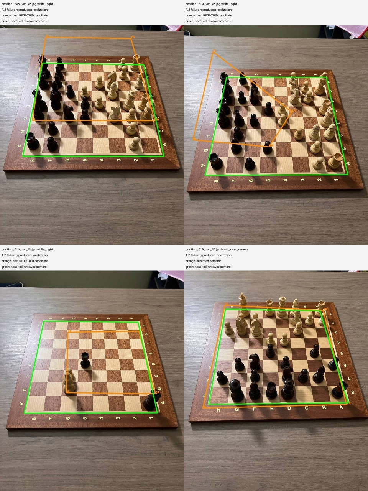
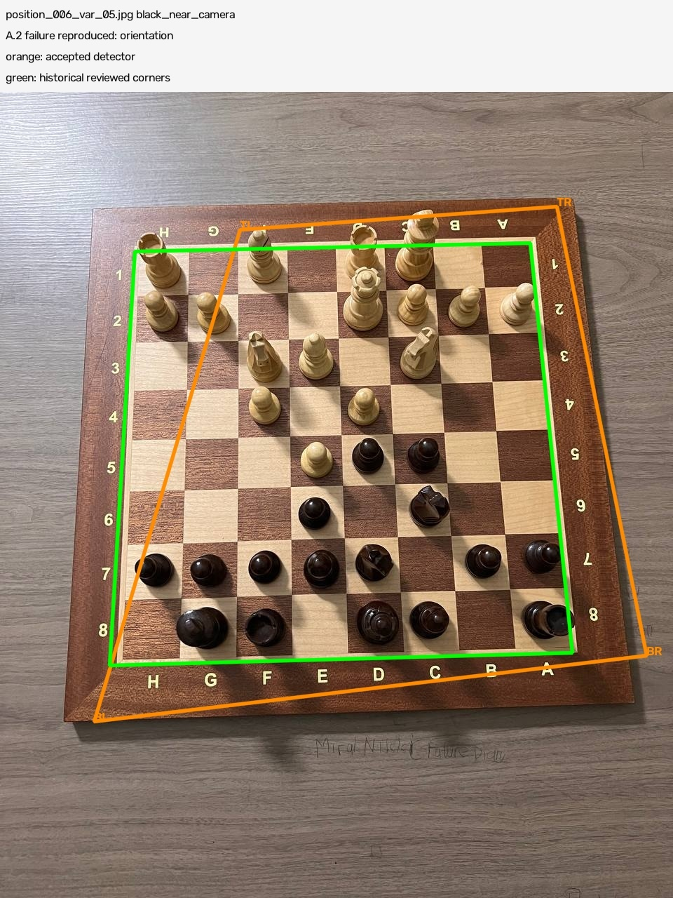
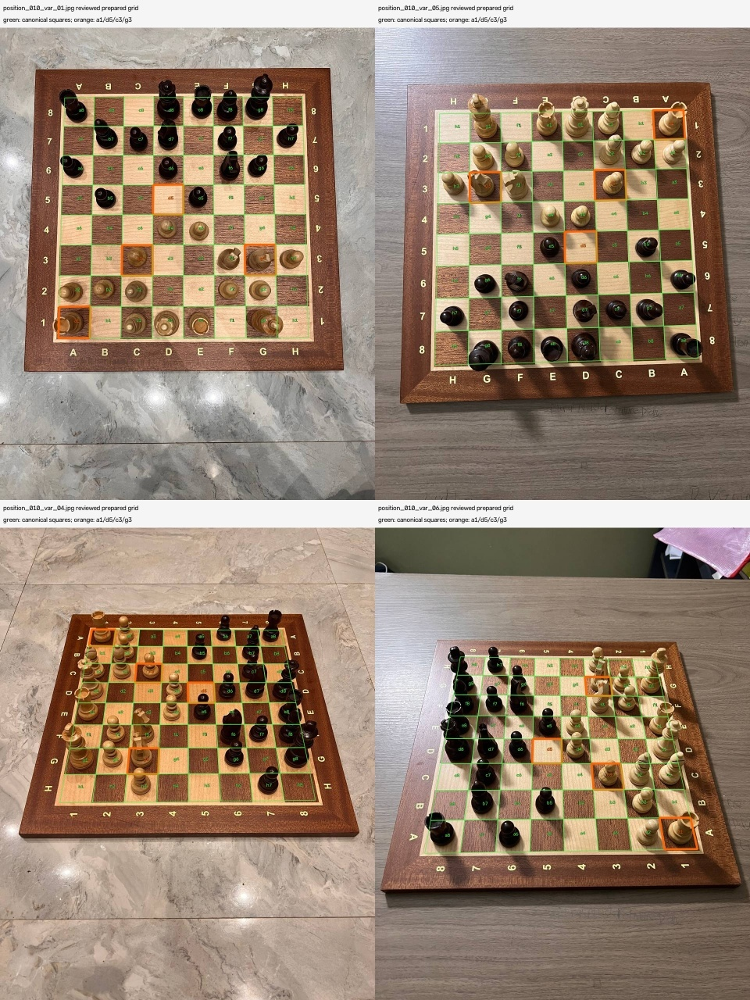
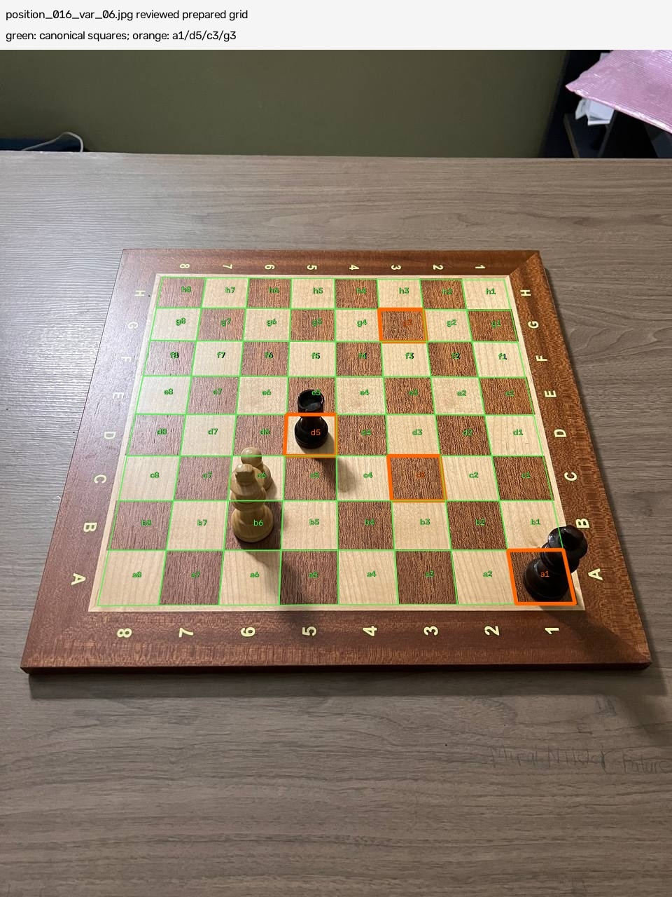
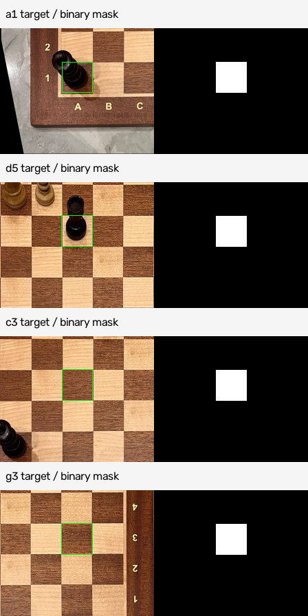

# Task B.1 — Board geometry and square alignment audit

2026-10-18. Status: audit complete; awaiting owner review. B.2 has not started.
The requested research and implementation documents are at repository root in this
checkout (`VISION_RESEARCH.md`, `IMPLEMENTATION_PLAN.md`), rather than under `docs/`.

Geometry/orientation is a confirmed obstacle to raw-photo completion. All 14 A.2
preparation failures reproduce at their original gates. Historical reviewed corners
restore 6/7 reference cases; reviewed corners plus known orientation restore 7/7.
Recognition still makes 27 square errors on those seven boards, with zero exact
boards. No corner-ordering, homography-direction, canonical-ID or target-mask
implementation defect was confirmed. No production algorithm was changed.

## Evidence and scope

Baseline: `a1_20261018_15a5a879`, source commit
`15a5a8792a41f1a11c9287f6061f90fb126858a3`, unchanged epoch-16 MobileNetV3 Small
checkpoint. Only the already inspected historical test positions 006/010/016 are
used. A.1's 58 protected inputs and the additional A.2/source-report hashes all
match: 99 distinct protected files checked before and after execution.
No new final holdout was opened. No model training, split changes, inference
changes, browser changes, commit or push occurred.

- Versioned numeric evidence: [geometry_results_b1_20261018.json](geometry_results_b1_20261018.json).
- Full local evidence: `outputs/evaluation/geometry_b1_20261018_run1/summary.json`.
- Full local gallery: `outputs/evaluation/geometry_b1_20261018_run1/failure_gallery.jpg`.
- Every failed raw image has a fresh `automatic/` attempt, detection diagnostics,
  `candidate_vs_reference.jpg`, `audit.json`, and any applicable rescue subfolders.
- All 23 reviewed prepared boards have `source_grid.jpg` and `target_masks.png`.

References are existing source-hash-bound corner overrides and current
human-approved prepared-board reviews. They are **historical reviewed references**,
not new independent metrology or newly verified photographs. Seven failed images
have no such reference; they were not assigned invented corners or labels.

## Pipeline and coordinate conventions

1. `prepare_raw_photo` reads the original BGR image. `detect_board` searches edge,
   closed-edge, wood-color and line quadrilaterals, including border insets, at
   maximum dimension 1280. Candidate checker correlation must be at least .40,
   contrast at least 8 and combined score at least .55. It refines leading candidates.
2. `order_corners` produces image-geometric TL/TR/BR/BL with x right, y down.
   The anchor is minimum x+y, ties by y then x. This is deterministic even for a
   diamond; it does not establish chess orientation. All 24 permutations are tested.
3. `warp_board_with_context` applies original-image → context homography once with
   cubic sampling. The playing-area corners map to (200,200), (999,200),
   (999,999), (200,999). The 1200×1200 context's board bounds are
   `[200,200,1000,1000]`, **exclusive** at right/bottom. The 799-pixel endpoint span
   is intentional. A separate nearest-neighbor validity mask marks source coverage.
4. `resolve_orientation` reads border glyphs on the camera-facing rectification.
   It does not inspect FEN or piece predictions. Gates include similarity .60,
   eight matches, score gap .12, two edges, three files and three ranks. Uncertain
   evidence stops the pipeline. Diagnostic `--white-side`/reference injection
   overrides semantics only; it cannot repair geometry.
5. `fit_grid` fits checker boundaries with the orientation-dependent checker phase;
   weak boundaries can be inferred. It emits camera-relative square polygons and
   source-image polygons. This is more than uniformly splitting a padded canvas.
6. `polygon_crop` adds 200 pixels around each actual target polygon. It may
   zero-pad beyond the context. The polygon is translated by the crop origin.
   The target square must have at least .99 source validity; context may contain
   padding. Black padding is not an occupancy or target mask.
7. `preprocess_context_crop` converts BGR to RGB, resizes RGB with area interpolation
   to 224×224 and normalizes with ImageNet values. It fills the local target polygon
   **before** nearest-neighbor mask resizing. The fourth channel is that binary
   square mask, not source validity. It covers roughly 45×45 pixels in a typical
   five-square-wide context, so neighboring pieces remain visible.
8. The classifier sees camera-facing crops. Canonical IDs and a final `np.rot90`
   of prediction rows apply semantic orientation; the RGB inputs are not rotated
   into White-near appearance.

| White's side | CCW quarters for output | Image TL | TR | BR | BL |
|---|---:|---|---|---|---|
| Bottom / White-near | 0 | a8 | h8 | h1 | a1 |
| Left | 1 | a1 | a8 | h8 | h1 |
| Top / Black-near | 2 | h1 | a1 | a8 | h8 |
| Right | 3 | h8 | h1 | a1 | a8 |

The browser uses a separate **semantic** corner order a1/h1/h8/a8 and a board→image
homography with board-plane coordinates 0..32 (4 per square), opposite geometric
image winding. These conventions must not be interchanged. `geometry.ts` projects
canonical polygons; `tracking.ts` composes current and inverse initial transforms.
The worker's scaled coordinates are converted back to full source pixels in
`useTracking.ts`; CSS display geometry is separate. Same-frame geometry/JPEGs and
stale-observation guards feed `scanning.recognition.prepare_keyframe`, which orders
geometric warp corners and projects the semantic polygons into that context.
Its rank-minus-one intermediate row field does not determine output identity;
canonical square keys do. Existing baseline/live crop-parity tests cover four sides.

A.2 evaluates the classical photo detector and glyph templates. It does **not**
measure the newer learned browser bootstrap, phone tracking drift, or video fusion.
Browser behavior was inspected and its existing tests run; it was not changed.

## Every unsuccessful raw image

Names below omit `position_` and `.jpg`. Localization rejection means no candidate
passed all evidence gates, not that there were no quadrilaterals. All 12 rejected
images generated candidates (173–928 each). Best-candidate score/correlation are
shown to make threshold failures explicit; contrast exceeded 8 in all 14 cases.

| Image | Camera side | First failing gate | Best score / correlation | Reviewed reference |
|---|---|---|---:|---|
| 006_var_01 | White-near | localization | .452 / .335 | unavailable |
| 006_var_02 | White-near | localization | .457 / .434 | unavailable |
| 006_var_03 | White-near | localization | .359 / .306 | unavailable |
| 006_var_04 | White-left | localization | .536 / .540 | unavailable |
| 006_var_05 | Black-near | orientation | .567 / .459 | available |
| 006_var_06 | White-right | localization | .371 / .269 | available |
| 006_var_07 | Black-near | localization | .499 / .356 | available |
| 006_var_08 | White-near | localization | .503 / .466 | unavailable |
| 006_var_09 | White-near | localization | .377 / .279 | unavailable |
| 006_var_10 | White-near | localization | .407 / .407 | unavailable |
| 010_var_05 | Black-near | localization | .539 / .387 | available |
| 010_var_06 | White-right | localization | .367 / .204 | available |
| 010_var_07 | Black-near | orientation | .591 / .483 | available |
| 016_var_06 | White-right | localization | .362 / .303 | available |

| Camera side | Attempts | Completed | Localization failures | Orientation failures |
|---|---:|---:|---:|---:|
| White-near | 18 | 12 | 6 | 0 |
| Black-near | 6 | 2 | 2 | 2 |
| White-left | 3 | 2 | 1 | 0 |
| White-right | 3 | 0 | 3 | 0 |
| Total | 30 | 16 | 12 | 2 |

No original failure reached grid fitting or classification. These are exact first
failure stages; the interventions reveal additional downstream gates below.
The 16 completed A.1 raw outputs all agree with capture metadata on semantic
rotation. Their A.2 recognition errors and 0/30 raw exact-board result are unchanged.

## Priority cases and interventions

Green is the historical reviewed playing area. Orange is the accepted detector
polygon, or explicitly the best **rejected** candidate. Rejected candidates were
never sent to the original classifier.



| Image | Candidate/reference IoU | RMS corner error, pixels / square widths | Confirmed observation |
|---|---:|---:|---|
| 006_var_05 | .697 | 106.85 / 1.42 | Accepted polygon cuts into board and includes border; no matching glyphs. |
| 006_var_06 | .457 | 170.40 / 2.43 | White-right best rejected polygon displaced upward; omits near ranks. |
| 006_var_07 | .627 | 99.83 / 1.52 | Black-near best rejected polygon mixes border and playing area. |
| 010_var_05 | .701 | 103.73 / 1.26 | Black-near best rejected polygon has wrong top edge and skew. |
| 010_var_06 | .275 | 280.73 / 3.89 | White-right best rejected polygon is grossly wrong. |
| 010_var_07 | .913 | 23.22 / .33 | Accepted polygon is close but shifted; border evidence insufficient. |
| 016_var_06 | .466 | 151.65 / 2.25 | White-right best rejected polygon covers only an interior subset. |

Square widths normalize by average reviewed board edge/8; IoU is planar polygon
overlap in original pixels. Neither measures occluded piece-base accuracy.
Only the top ten candidates are retained by the detector. A bad top candidate
does not prove the search never generated a better physical boundary.



All rescues use the unchanged `prepare_raw_photo` → grid fit → `predict_rectified`
workflow, checkpoint and preprocessing. FEN comparison occurs after prediction.
These are diagnostic reference interventions, **not improved automatic metrics**.

| Image | Reviewed corners, automatic orientation | Reviewed corners + known orientation | Saved prepared errors |
|---|---|---:|---:|
| 006_var_05 | completes, 3 errors | completes, 3 errors | 3 |
| 006_var_06 | completes, 3 errors | completes, 3 errors | 3 |
| 006_var_07 | completes, 3 errors | completes, 3 errors | 3 |
| 010_var_05 | completes, 7 errors | completes, 7 errors | 7 |
| 010_var_06 | orientation uncertain | completes, 3 errors | 3 |
| 010_var_07 | completes, 6 errors | completes, 6 errors | 6 |
| 016_var_06 | completes, 2 errors | completes, 2 errors | 2 |

All successful automatic orientations in this table are semantically correct.
Combined-reference results reproduce each saved prepared error count: 27/448
incorrect squares, 93.97% square accuracy, 0/7 exact boards. This is a selected
seven-board intervention subset, not the 23-board prepared benchmark or an
occupied-square metric.

Two additional orientation-only experiments retain the **automatic** corners:

- `006_var_05`: supplied correct orientation still fails grid fitting. Reviewed
  corners alone restore the automatic glyph result. The orientation-stage symptom
  therefore has a confirmed upstream geometry contribution.
- `010_var_07`: supplied correct orientation completes with 5 square errors.
  Automatic glyphs had the correct rotation as top candidate with nine matches
  on two edges, but only **one file letter** and eight ranks; the three-file gate
  rejects it. Reviewed corners alone recover enough glyph evidence. This is
  orientation-evidence sensitivity, not a silent 180-degree mapping error.

`010_var_06` exposes an additional semantic gate even with reviewed geometry:
the glyph resolver remains uncertain. Its historical preparation likewise used
capture-metadata orientation. Correct corners alone cannot solve every raw failure.

## Alignment and classifier isolation



Top row: White-near and Black-near. Bottom row: White-left and White-right.
Visual inspection against the physical printed coordinates agrees with canonical
labels, including a1 and the interior targets. A second sparse White-right board
also places the a1 and d5 masks over the intended physical bases:



Across all 23 approved prepared test boards, all **1,472** regenerated crops match
saved crop pixels and 4-channel preprocessing exactly. Target masks match a
separate polygon rasterization, canonical IDs agree, and all target source-validity
fractions pass .99. Maximum context→source→context roundtrip error is .000111
pixels (rounded upward). Internal numerical consistency alone cannot prove the
physical geometry, hence the raw overlays and historical human references.



This White-near sparse board illustrates a1/d5 and empty c3/g3. The binary mask
selects the square surface, not a silhouette. Tall pieces extend above the mask
into neighboring projected squares; context and padding remain visible. In the
White-right rescue `016_var_06`, a1 and d5 still misclassify despite base-aligned
targets. These are residual recognition/representation errors under reviewed
geometry, not evidence of a square-index shift. Occlusion and 3D appearance remain
possible causes; this audit does not isolate their individual effects.

Confirmed: incorrect automatic localization and geometry-sensitive glyph evidence
block raw completion; residual classifier errors persist with reviewed geometry.
Not confirmed: a shared corner-order, transform-direction, quarter-turn, padding
offset or target-mask arithmetic defect. No threshold relaxation or architecture
change is justified by this small, already inspected test set.

## Reproduction and validation

Run from repository root using the existing local environment and historical data:

```bash
.venv/bin/python scripts/audit_board_geometry.py --output-dir outputs/evaluation/geometry_b1_20261018_run1
.venv/bin/python -m pytest tests/test_geometry_audit.py tests/test_perspective.py tests/test_grid_geometry.py tests/test_scan_recognition.py -q
.venv/bin/python -m pytest tests/test_geometry_audit.py -q
.venv/bin/python -m pytest tests --ignore=tests/test_engine.py -q
PATH="$PWD/tools/node/bin:$PATH" npm --prefix web test
git diff --check
```

The displayed audit output directory already exists; choose a **new unused** suffix
to reproduce. The tool refuses overwrite, checks protected hashes before/after,
and fails if a raw gate no longer reproduces. Missing local data/checkpoint or
stale human reviews are errors, not fabricated metrics. Full output is ignored
by Git; the compact JSON and five representative images are versionable evidence.

New code: standalone read-only `src/vision/geometry_audit.py` and
`scripts/audit_board_geometry.py`; new regression tests in
`tests/test_geometry_audit.py`. No production path imports the audit module.
Tests cover all corner permutations including diamond ties, projective all-64
semantic mapping across four sides, exact camera-facing crop content including
zero padding, target-mask centers, localization-error measurement, and all 448
square centers in the seven historical reviewed failure cases. Existing browser
tests include perspective, quarter-turn identities, CSS/source coordinates and
full-circle synthetic tracking. They do not establish real-phone tracking accuracy.

Validation totals and exclusions are recorded in the accompanying numeric report.
The initial new synthetic test incorrectly used NumPy slices beyond context
boundaries; its expectation was corrected to explicit zero padding. This was a test
assumption error, not a production defect. Final validation has no remaining failures.

## Acceptance and next work

- [x] Coordinate mappings pass synthetic projective cases and historical reviewed
  cases; representative raw overlays checked against printed board coordinates.
- [x] No unintended 90/180-degree semantic remapping found in tested completed
  photo/live paths. Unresolved glyph evidence remains an explicit rejection.
- [x] Crop/mask alignment and residual recognition failures separated through exact
  crop parity, raw projections and controlled geometry/orientation interventions.
- [x] Every A.2 failed raw image attributed to its reproduced first gate; all three
  White-right and four Black-near failures investigated with available references.
- [x] Diagnostic images, regression tests, provenance and preservation checks supplied.
- [x] No retraining, YOLO, fusion/UX modifications, final-holdout use, commit or push.

B.1's audit acceptance criteria are met within the stated historical-data scope.
They do not assert robust automatic localization or exact board reconstruction.
Seven failed photographs still lack independently reviewed geometry; lighting,
viewpoint, room and position are confounded, so no general side-specific cause is
established. There is no continuous annotated phone sequence in this audit from
which to quantify tracking drift or recovery.

Prioritize geometry for raw completion: obtain reviewed development-only corners
for the seven missing references, then evaluate candidate coverage, boundary
quality and glyph sensitivity separately on A.3 pilot/development sequences.
Measure corner RMS in square units, board IoU, per-square/base assignment and
temporal drift independently of semantic rotation correctness/abstention. Do not
lower the detector or glyph thresholds using these historical test failures.
Recognition remains necessary for exact boards: preserve the oracle-geometry
benchmark and later examine black rook/king and context/occlusion errors in a
separate approved task. Proceed to B.2 only after owner review; no B.2 work started.
