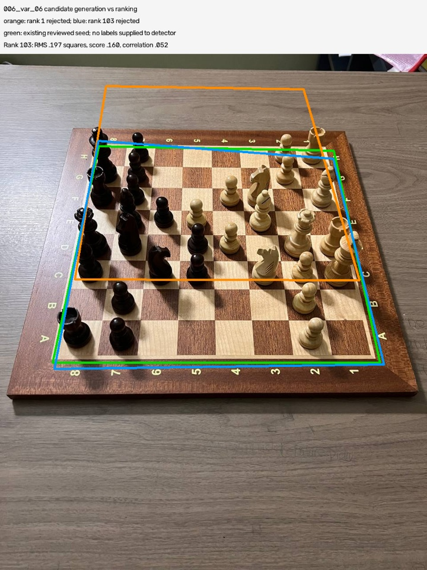
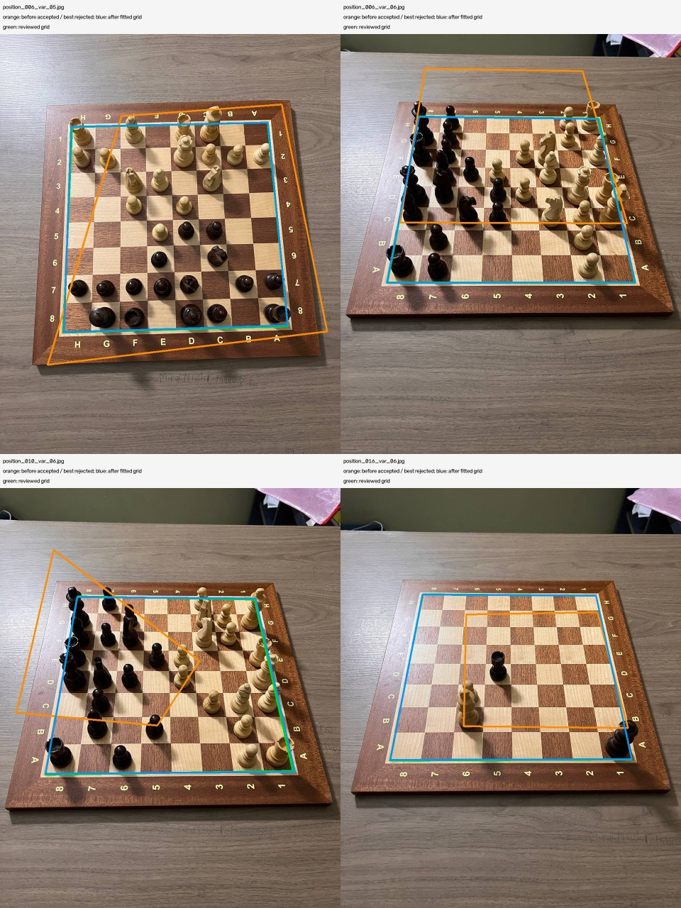
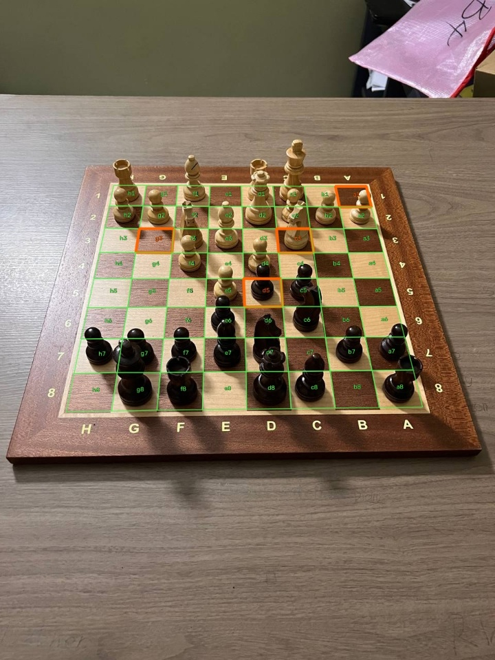
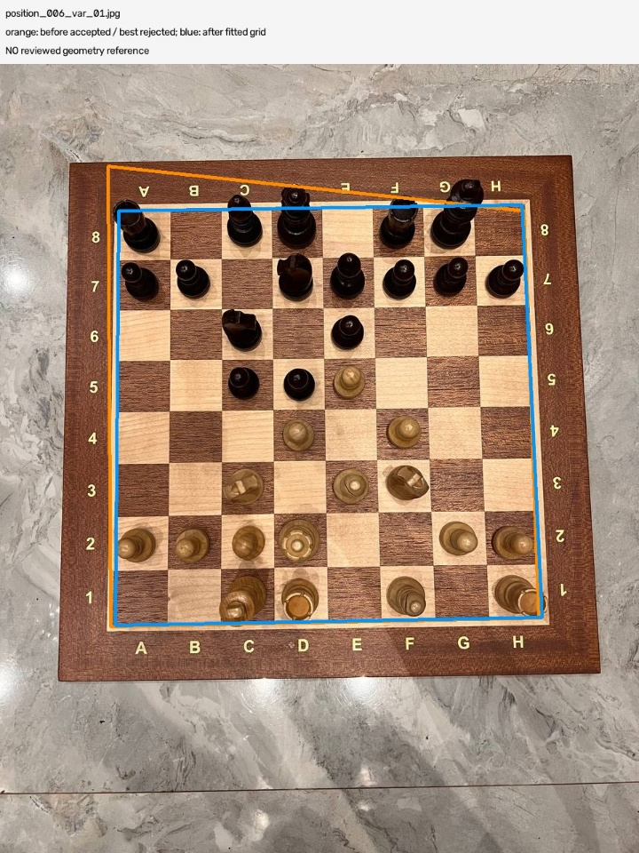

# Task B.1b — Geometry reliability improvements

2026-10-18. Development evaluation on the same 30 historical raw photographs
used in A.2/B.1. **These are not unbiased generalization results.** No A.3 final
holdout was opened. No model training, YOLO, crop/mapping change, fusion or browser
UX change occurred. B.2 has not started.

## Diagnosis: candidate generation versus ranking

The frozen detector's normal diagnostics retain only ten candidates. A temporary
profiling callback now captures its complete local candidate list at return,
restoring the previous callback even on error. This inspection does not modify
generation/ranking and is never used by runtime recovery. References are joined
after detection. The 30 searches reproduce historical acceptance and accepted corners.

A seed is within the diagnostic tolerance if RMS corner error is ≤0.25 average
square widths and maximum corner error ≤0.5 square widths, relative to the
historical reviewed homography seed. This is an explicit engineering tolerance,
not independent physical metrology. Fitted-grid accuracy is measured separately.

| Failed reference case | Candidates | Closest seed's score rank | RMS, squares | Score / correlation | Any seed within tolerance? |
|---|---:|---:|---:|---:|---|
| 006_var_05, Black-near | 623 | 7 | .200 | .348 / .267 | yes |
| 006_var_06, White-right | 538 | 103 | .197 | .160 / .052 | yes |
| 006_var_07, Black-near | 653 | 9 | .193 | .323 / .254 | yes |
| 010_var_05, Black-near | 928 | 134 | .743 | .155 / .039 | no |
| 010_var_06, White-right | 423 | 209 | 1.109 | .098 / .027 | no |
| 010_var_07, Black-near | 753 | 7 | .301 | .453 / .300 | no |
| 016_var_06, White-right | 533 | 33 | .439 | .141 / .067 | no |

All three within-tolerance seeds fail the unchanged checker gates. Their failures
involve ranking/evidence, not just generation. For the other four, reranking alone
cannot produce a seed meeting this tolerance. The .301/.439 cases are coarse
approximations, not proof that refinement could never recover them. Seven other
failed photographs have no reviewed geometry, so their candidate accuracy is unknown.



Blue is the rejected rank-103 seed, orange the rejected leader, green the existing
reviewed seed. Neither reference nor oracle ranking is used by runtime recovery.

All three White-right leaders are `line_geometry` hypotheses. The detector retains
the eight longest distinct Hough lines per coarse axis family. Long diagonals and
interior lines crowd out outer boundaries. Intersections then clip/misplace the
board; insets only shrink them further, and only three leading candidates are refined.
Read-only line-pool inspection confirms this loss of near-boundary proposals:

| White-right image | Raw Hough segments / retained lines | Top edge: closest raw / retained error | Left edge: closest raw / retained error |
|---|---:|---:|---:|
| 006_var_06 | 182 / 16 | .088 / 2.257 | .099 / 1.082 |
| 010_var_06 | 175 / 16 | .042 / 2.167 | .138 / 1.037 |
| 016_var_06 | 94 / 16 | .074 / .652 | .054 / 1.026 |

Errors are mean perpendicular distances from reviewed edge endpoints to the
infinite proposed line, in square widths. This measures line availability, not
segment-endpoint accuracy. `010_var_06` also lacks a close raw bottom-edge line
(.673 squares). Simply increasing the cap would expand combinations while retaining
the ambiguous scorer; it was investigated, not implemented as an assumed fix.

In Black-near `006_var_05`, the accepted `wood_color` polygon passes broad convexity,
area, aspect and rectangularity checks despite clipping the board and including
its frame. Correlation .459 and contrast 35.64 yield score .567, above .55.
Refinement shifts a vertex by up to 66.28 working-image pixels while optimizing
that same evidence. A convex polygon and scalar checker score do not prove an
8×8 playing-area boundary. Lowering thresholds to admit the useful rank-seven
seed (.348) would admit weak alternatives too. B.1 already showed that forcing
orientation on the accepted wrong polygon still fails grid fitting.

## Minimal implementation

Added `src/vision/geometry_reliability.py` and the explicit
`--geometry-policy marked-board` option in `scripts/predict_position.py`.
The default remains `legacy`. Opt-in runs require automatic raw input, no manual
overrides, and a new image output directory. Frozen A.1 source/config files remain
byte-for-byte intact, including the detector and orientation resolver.

1. Try unchanged `prepare_raw_photo`. Preserve successful canvases, grids,
   orientation and provenance without running another reader.
2. On explicit localization/orientation/grid failure, reuse the existing
   `scanning.bootstrap.bootstrap_image` learned-marking/fast-acquisition paths.
   Existing component proposals, frozen board-font reader, alternative outlines
   and spatial registration supply independent boundary and semantic evidence.
3. Require learned registration: at least eight spatial inliers, three distinct
   files and ranks, two-dimensional spread and existing RANSAC consistency.
   Competing geometries and learned/template orientation conflicts remain rejections.
   A template-only fallback is insufficient for this policy.
4. Preserve existing grid support ≥.25 and refinement shift ≤.45 square-width
   gates. Check finite residuals within the existing 6-pixel RANSAC tolerance,
   semantic winding/homography, and all 64 identity-preserving polygons.
5. Reuse unchanged raw warp/grid and classifier preprocessing. Verify that the
   fitted boundary supplied to crops matches the bootstrap-validated boundary.
   Carry automatic provenance and `geometry_review_required`; never mark recognized
   corners as verified ground truth.

This is an explicitly selected **alternate evidence policy**, not a lowered checker
threshold. Scores remain uncalibrated. Previously successful preparations are
preserved, not newly certified. Recovery is specific to the current marked wooden
board/font and requires the existing `board_marking_reader.pt`. Missing reader or
evidence leaves an explicit failure/reason. No dependencies were downloaded.
The reader's documented training excludes positions 006/010/016; development on
these same images still prevents an unbiased improvement claim.

Stricter shape heuristics cannot certify chess boundaries, reranking cannot supply
missing seeds, and wider refinement still optimizes ambiguous periodicity. Reusing
existing independent labels was the smaller supported change. Browser code is unchanged.

## Paired results and geometry correctness

Numeric evidence: [geometry_reliability_results_b1b_20261018.json](geometry_reliability_results_b1b_20261018.json).
Full local evidence: `outputs/evaluation/geometry_b1b_20261018_run2/summary.json`.
The exploratory complete run and final repeat agree on outcomes and predicted boards.
Before means `legacy`; after means opt-in `marked-board`. The default legacy
policy still completes 16/30.

| Camera side | Attempts | Completed before → after | Localization accepted before → after | Correct semantic outputs before → after | Exact boards before → after |
|---|---:|---:|---:|---:|---:|
| White-near | 18 | 12 → 18 | 12 → 18 | 12 → 18 | 0 → 0 |
| Black-near | 6 | 2 → 6 | 4 → 6 | 2 → 6 | 0 → 1 |
| White-left | 3 | 2 → 3 | 2 → 3 | 2 → 3 | 0 → 0 |
| White-right | 3 | 0 → 3 | 0 → 3 | 0 → 3 | 0 → 0 |
| Total | 30 | **16 → 30** | **18 → 30** | **16 → 30** | **0 → 1** |

Before: 12 localization and two orientation rejections. After: no localization,
orientation, grid or inference rejection on this development set. Semantic correctness
means agreement with historical capture orientation; 23 cases also have current
human-approved board reviews. Completion alone does not establish correct geometry.
By side, original failures were White-near 6 localization, Black-near 2 localization
and 2 orientation, White-left 1 localization, White-right 3 localization. Each
orientation has zero preparation failures under the new policy on these inputs.

Fitted polygons are projected into raw pixels and compared with reviewed fitted
source-square polygons. Strict outer agreement uses the .25 RMS/.5 maximum corner
tolerance. Square association checks all 64 cell centres against corresponding
reviewed physical polygons; per-square IoUs and corner errors are exported too.

| Side | Reviewed-reference population | Strict geometry + completion before → after | All 64 centres agree before → after | After completion without reference |
|---|---:|---:|---:|---:|
| White-near | 12 | 12 → 12 | 12 → 12 | 6 |
| Black-near | 6 | 2 → 6 | 2 → 6 | 0 |
| White-left | 2 | 2 → 2 | 2 → 2 | 1 |
| White-right | 3 | 0 → 3 | 0 → 3 | 0 |
| Total | 23 | **16 → 23** | **16 → 23** | **7** |

All 448 square centres in the seven new referenced results agree. Those boards
have 21 classification errors and one exact board (`006_var_07`), versus 27 errors
and no exact boards in B.1's supplied-reference intervention. This is different
automatically fitted geometry, not a model improvement or proof that reference
seeds are exact. Homography/context-sampling differences can affect classification
despite correct square identity.

All 16 original successes retain predicted placements and incorrect-square lists;
probability and crop-geometry parity checks are in the numeric report. No observed
regression. All 30 after outputs have 99/1,920 square errors (94.84% accuracy).
The before 95.02% covers only 16 completed boards: these conditional accuracies have
different denominators. **29/30 boards remain incorrect.** Prepared A.1/A.2 metrics
and all frozen artifacts remain unchanged.

This is still-photo recovery, not a live-latency improvement. Observed desktop
preparation-plus-inference medians were 5.57 seconds on the 16 retained legacy
cases and 8.35 seconds on the 14 recovery cases. They are different image groups,
not a controlled estimate of incremental overhead or a phone benchmark.

## Diagnostics



Orange: accepted legacy polygon (`006_var_05`) or best rejected polygon (three
White-right cases). Blue: new fitted boundary. Green: existing reviewed fitted
boundary. Blue/green overlap closely; numeric differences are reported separately.





The final image retains “NO reviewed geometry reference.” Neither appearance nor
correct orientation upgrades it to verified localization. Every image has full
local before/after diagnostics and canonical-grid overlays.

## Reproduction and tests

Use the existing `.venv`, checkpoints and local images. Choose new unused output
directories; previously generated evaluation artifacts are never overwritten.

```bash
.venv/bin/python scripts/evaluate_geometry_reliability.py candidates --output-dir outputs/evaluation/geometry_b1b_candidates_new
.venv/bin/python scripts/evaluate_geometry_reliability.py line-pool --output-dir outputs/evaluation/geometry_b1b_lines_new
.venv/bin/python scripts/evaluate_geometry_reliability.py evaluate --candidate-cache outputs/evaluation/geometry_b1b_candidates_new --output-dir outputs/evaluation/geometry_b1b_new
.venv/bin/python scripts/predict_position.py data/raw/position_006_var_06.jpg --geometry-policy marked-board --output-dir outputs/evaluation/geometry_b1b_cli_new
.venv/bin/python -m pytest tests/test_geometry_reliability.py -q
.venv/bin/python -m pytest tests --ignore=tests/test_engine.py -q
PATH="$PWD/tools/node/bin:$PATH" npm --prefix web test
git diff --check
```

The original candidate capture used the same read-only profiling method before
packaging as the `candidates` command. Its 30 pools are in
`outputs/evaluation/geometry_b1b_20261018_diagnosis/`. The evaluator source-binds them
to the frozen prepared manifest and historical detector outcome/corners. It hashes
the pools, raw inputs, frozen A.1/A.2 inputs, B.1's entire output tree and A.3 source
files before/after, and rejects code changes during a run. Candidate reflection is
diagnostic only and depends explicitly on the frozen function's local variables.

Final test totals, repeat/parity checks and artifact hashes are recorded in the
numeric report. New tests cover legacy preservation; unavailable, competing and
conflicting evidence; two-axis support; nonfinite residuals; grid drift; mirrored
or reassigned geometry; all four camera sides; safe CLI options/output handling;
and actual preparation of all seven reviewed B.1 failures. Unrelated Stockfish
engine tests are excluded. No new photographs were automatically labeled verified.

Final validation: **47 focused tests, 432 broader Python tests and 39 browser tests
passed**. CLI recovery succeeds; default legacy rejection and conflicting-input/
overwrite rejections are expected and verified. The packaged inspector reproduces
all 538 cached candidates for `006_var_06`. All 357 protected files still match,
including frozen A.1/A.2 inputs, B.1 outputs, A.3 sources, cached pools and raw
photographs. Diff/syntax/whitespace checks pass. No remaining test failures.

## Remaining limitations and recommendation

- No unresolved preparation failures on these 30 development images. Geometry
  remains unverified for `006_var_01/02/03/04/08/09/10`: six White-near, one White-left.
- Legacy candidate-generation/ranking limitations remain under the default policy.
  Recovery depends on readable current-board markings; other boards/fonts and
  unreadable borders have no established robustness here.
- No new independent sessions or continuous tracking ground truth were collected.
  Static-photo results do not establish real-phone tracking/recovery performance.
- Recognition remains the main residual obstacle on reviewed completed boards.

B.1b's diagnosis, implementation, paired metrics, diagnostics and regression checks
are complete. Recommend B.2 **after review**, using unchanged prepared-geometry
comparisons for crop experiments. Validate opt-in recovery on A.3 pilot/development
captures before default rollout, and obtain human geometry reviews for the seven
missing references. Further historical-set tuning cannot replace that validation.
Keep the final holdout sealed. No B.2 work, training, commit or push was performed.
