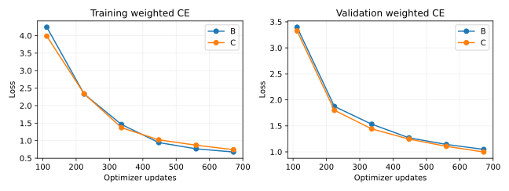

# C.7 — Direct Chesscog-to-personal adaptation

**Completed: both authorized branches ran all 672 updates and six training/validation intervals, with checkpoint reload and persistent exports. Retain frozen B.2.** Personal adaptation substantially improves the synthetic-only checkpoint, but both new models underperform B.2; the video treatment regresses this matched validation comparison. No production replacement or further training occurred.

| Same 25 validation photos | Overall | Occupied | Empty false positives | Exact boards |
|---|---:|---:|---:|---:|
| Frozen B.2 | 1566/1,600 (97.88%) | 445/468 (95.09%) | 11/1,132 (0.97%) | 7/25 |
| Chesscog before adaptation | 1189/1,600 (74.31%) | 64/468 (13.68%) | 7/1,132 (0.62%) | 0/25 |
| B: Chesscog → photos | 1418/1,600 (88.63%) | 309/468 (66.03%) | 23/1,132 (2.03%) | 0/25 |
| C: Chesscog → photos + video | 1394/1,600 (87.12%) | 286/468 (61.11%) | 24/1,132 (2.12%) | 0/25 |

Collected billing: **$0.36 aggregate metered increase**, versus $0.31740325 currently itemized to the two C.7 GPU Apps. The snapshot discrepancy is retained, not presented as a reconciled invoice. Both are below the $3 authorization. All C.7 Apps are stopped, zero tasks. **109 Python tests, 39 browser tests, and 5,389 protected-file hashes passed.**

2026-10-27. One seed (42), two bounded adaptation branches, fixed B.2 representation. Development-validation evidence only. No ChessReD retrieval, production replacement, test-photo evaluation or final holdout access.

## Contract and approved data

Both branches initialize independently from `outputs/evaluation/chesscog_c5/checkpoints/chesscog_best.pt`, SHA-256 `11c54e55cd77ffa9fd8530dc75283a5d77953bbb66f0018b8a1f9deca049f1c9`. Its original C.5 configuration/hash is bound in `configs/training/personal_c7_authorized_v1.json`. The preregistered design is [personal_finetuning_c7_design.md](personal_finetuning_c7_design.md).

Architecture remains MobileNetV3 Small, 1,531,325 parameters, the existing 13-class order and four-channel RGB+target mask. B.2 `context1_224` crop extraction, interpolation, normalization, orientation and class mapping are unchanged. Production code, C.4 trainer and historical D/E ChessReD-parent checks are unchanged. A separate C.7 wrapper enforces the exact parent hash; internally both branches reuse C.4's existing B parent-stage policy, explicitly distinguished from C.7 scientific branch identity. No ChessReD checkpoint is fabricated.

| Source | Train | Validation | Status |
|---|---:|---:|---|
| Approved personal photos | 112 / 7,168 squares | 25 / 1,600 squares | Frozen position assignments and labels |
| Owner-reviewed retired D.3c frames | 77 / 4,928 squares | 0 | Nine positions; training only |
| Position 03 video | 0 | 0 | Ten reviewed frames remain quarantined |
| Historical test photos / original five pilot videos / final holdout | 0 | 0 | Not used |

The union export has 214 boards and 13,696 square records, including validation. Every packed input reproduced its frozen B.2 or reviewed-frame SHA-256. Replaying the attributed human review reproduced all 87 original decisions exactly. Canonical FEN labels, source/frame/PTS, geometry and crop hashes are retained; model predictions never establish truth. No training/validation group conflict exists. There are 12 photo training positions, nine additional video placements and three validation positions (003/007/011). Historical photo session IDs remain unknown. Owner review establishes sufficient alignment for use, not pixel-perfect corners or newly supplied reference photos. Stale pending-review descriptive strings in historical manifests are preserved; explicit attributed checks and exact review replay govern eligibility.

Only compact prepared contexts, valid masks and provenance are exported/uploaded; no original videos are copied. The derived bundle is approximately 498 MiB. Original recordings are decoded only for the approved frame export because a complete compact training bundle did not already exist. All original media and historical manifests remain immutable.

## Matched training and exposure

Adam LR3e-5; StepLR gamma.9 per112-update interval; six intervals/672-update ceiling; batch64; bf16; workers0; first interval head+stem, remaining intervals full backbone. Same original photometric/noise/blur augmentation and photo-derived class weights in both branches. Validation occurs every112 updates and selects minimum weighted cross-entropy. Patience6 avoids asymmetric early stopping before the nominal six intervals. Each loop is capped at1,800 seconds and each L4 function at2,400 seconds, with one committed attempt marker per branch and no automatic retries/resumption.

Branch B uses photos only. Branch C uses the existing .5 source-probability, position-balanced sampling within each source, then frame sampling. Across the prespecified672 batches, B has43,008 photo-square exposures; C has19,648 photo and23,360 video exposures (54.3% video). This replaces some photo replay rather than adding updates. Source/class/position exposures are saved in `outputs/evaluation/personal_c7/data_audit_v1.json` and each branch's `exposure.json`. Both have identical validation data. Fewer independent positions than square observations and correlated video frames limit interpretation.

## Transfer references before adaptation

All four models are to be compared on the identical25 approved validation photographs, including exact frame/square/label-order verification. These are three repeatedly exposed physical positions, not an independent test set. Historical prepared-test and D.3c figures use different examples and must not be mixed with this table.

| Model | Overall | Occupied | Empty false positives | Exact boards |
|---|---:|---:|---:|---:|
| Frozen historical B.2 | 97.88% | 95.09% | 11/1,132 | 7/25 |
| C.5 Chesscog, before adaptation | 74.31% | 13.68% | 7/1,132 | 0/25 |

The synthetic checkpoint alone transfers poorly to these real images; its synthetic validation does not establish physical-board utility. The completed adaptation results appear below. Synthetic-only and adapted checkpoints use the same CPU evaluation path for the primary comparison.

## Upload recovery and budget

The initial whole-directory upload failed in the Modal client with SSL closures followed by `grpclib` `AttributeError: 'Connection' object has no attribute '_transport'`, before any GPU training invocation. The bounded recovery publishes at most four files per upload batch in a fresh directory, with manifest/inventory last. Original SDK/application dependencies were not upgraded. Training must validate every uploaded inventory member before proceeding.

Authenticated workspace: `akwasipoku-oforiagyei`, environment main, existing C.4 data/artifact Volumes, NVIDIA L4 with CPU2/8GiB. Current rate query confirms $0.9586/hour for those requested resources. Two40-minute function limits plus two5-minute startup allowances imply $1.4379; adding $.30 ancillary reserve yields a conservative $1.7379 plan under the authorized combined$3. Live remaining credits and a hard workspace spend cap are not exposed by available queries; no billing settings changed. Bounds are not an account billing guarantee. Baseline usage and subsequent resource snapshots are retained separately; continuing storage may accrue.

## Reproduction

```bash
.venv/bin/python scripts/export_multidataset_c4.py --manifest outputs/evaluation/multidataset_c4/personal_manifest_v1.json outputs/evaluation/multidataset_c4/video_manifest_verified_v1.json --output outputs/evaluation/personal_c7/bundle_v1 --require-video
.venv/bin/python -m modal run scripts/modal_personal_c7.py --action upload --bundle-id personal-c7-bundle-v2
# Exactly one separately authorized invocation per branch, after successful upload:
.venv/bin/python -m modal run scripts/modal_personal_c7.py --action train --branch B --bundle-id personal-c7-bundle-v2
.venv/bin/python -m modal run scripts/modal_personal_c7.py --action train --branch C --bundle-id personal-c7-bundle-v2
.venv/bin/python -m modal run scripts/modal_personal_c7.py --action export --branch B
.venv/bin/python -m modal run scripts/modal_personal_c7.py --action export --branch C
```

Fresh outputs and one-attempt claims intentionally prevent replaying completed jobs. No automatic resumption is authorized. CPU evaluation reuses `scripts/evaluate_multidataset_c4.py` with the bundle manifest/root and threads2; `scripts/report_personal_c7.py` verifies observation identity and produces a compact board/crop comparison without rerunning inference.


## Completed training, checkpoints and reproducibility

Both branches selected update672 (minimum weighted validation loss) and completed the prescribed six intervals; these are fixed 112-update sampling intervals, not six exhaustive passes through every eligible frame. This is completion of the **bounded C.7 schedule**, not evidence of convergence or completion of the full multi-dataset campaign. No interruption/resumption or extra seed was launched. Both latest checkpoints include optimizer, scheduler, scaler, RNG and cursor state; the unchanged C.4 interrupted-replay regression passed. No actual C.7 continuation was used to demonstrate resumption.

| Branch | Kernel time | Last interval train loss | Selected validation loss | Peak torch GPU allocation | Sampled GPU utilization |
|---|---:|---:|---:|---:|---:|
| B | 516.93 s | 0.675360 | 1.046830 | 647,749,632 bytes | 3.86% |
| C | 532.52 s | 0.741469 | 0.996830 | 647,749,632 bytes | 1.44% |



Training and validation losses continued declining at the ceiling. That supports calling the run bounded, not declaring that more training would necessarily help. The loss observer preserves the original cross-entropy/gradients. Labels, class weights and checkpoint criteria were not changed after observing results. GPU utilization is sampled, not a full profiler; the workload remains substantially input/CPU/Volume bound.

Checkpoint exports (all outside Git):

| Branch/file under `outputs/evaluation/personal_c7/checkpoints/` | SHA-256 |
|---|---|
| `B/chesscog_personal_photos_best.pt` | `9ce16c51d2b64d52c460013b3adffcc3bd72ed80ebb408b5e69abc50aff2677c` |
| `B/last.pt` | `8694e62c8bb7f0fbfeb0661d1b1edc29906f322d8ffacade67e2bd43d828ec8a` |
| `C/chesscog_personal_multiview_best.pt` | `e7af037d9cd1924b34ae618a1a5b48ab67b546c5b19db8e10ecacbcf5ad3e1d6` |
| `C/last.pt` | `e0560386576767e85b1bbb3690f6e7fc6ea91d8a99402d6a354c6581a5d832dc` |

Remote directories are `chess-vision-c4-artifacts-v1:/personal-c7-b-seed42-v1/` and `/personal-c7-c-seed42-v1/`. Each preserves its authorized effective configuration, source hashes, exposure, metrics, one-attempt claim, best and latest weights. Both best/latest exports match remote SHA-256s, parent hash, plan hash and runtime dataset fingerprint. All seven executed training/model/preprocessing module hashes match locally. Runtime-rebased dataset fingerprints differ from the raw portable manifest hash by design. The selected best was strictly loaded and evaluated on CPU; latest reload had identical logits within the original L4 process.

There is a **net one-square confusion-matrix difference** between B's saved GPU validation (88.56% overall/65.81% occupied) and CPU replay (88.625% overall/66.03% occupied): the CPU matrix adds one correct white king and removes one white-king→black-queen count. A near-tied e1 example has a .00145 top-two probability margin and is a plausible source, not a certified identification: per-square GPU logits were not retained, so compensating prediction changes cannot be excluded from aggregate matrices. Source/input hash checks passed; backend/batch numerical differences are plausible, not conclusively isolated. C's CPU matrix matches its saved GPU matrix exactly. Both raw matrices are preserved. All four primary results use the identical CPU FP32 batch16/threads2 path; no CPU outcome reselected a checkpoint.

## Position, piece-class and paired error analysis

There are only **three validation positions**. Photo capture-session IDs are absent; 25 photos and 1,600 squares must not be treated as 25 or 1,600 independent positions.

| Physical position | Photos | B.2 occupied | Chesscog occupied | B occupied | C occupied |
|---|---:|---:|---:|---:|---:|
| position_003 | 9 | 95.19% | 14.44% | 65.93% | 61.11% |
| position_007 | 6 | 94.64% | 12.50% | 67.26% | 61.31% |
| position_011 | 10 | 96.67% | 13.33% | 60.00% | 60.00% |

C is worse than B on positions003 and007, tied on011. There is no position-level evidence here that the extra video treatment improves validation robustness. Results by semantic camera orientation, complete per-board errors and all confusion matrices are in the machine-readable comparison; small orientation subgroups are descriptive only.

[Full per-class precision/recall CSV](personal_finetuning_c7_classes_v1.csv). Selected recalls:

| Class | Support | B.2 | Chesscog | B | C |
|---|---:|---:|---:|---:|---:|
| white pawn | 115 | 97.39% | 0.87% | 77.39% | 57.39% |
| white knight | 30 | 96.67% | 3.33% | 50.00% | 50.00% |
| white rook | 30 | 100.00% | 6.67% | 76.67% | 83.33% |
| white queen | 15 | 100.00% | 13.33% | 53.33% | 73.33% |
| white king | 25 | 100.00% | 8.00% | 72.00% | 72.00% |
| black pawn | 105 | 98.10% | 10.48% | 81.90% | 75.24% |
| black knight | 30 | 83.33% | 26.67% | 20.00% | 26.67% |
| black rook | 30 | 100.00% | 20.00% | 73.33% | 73.33% |
| black queen | 15 | 46.67% | 46.67% | 40.00% | 33.33% |
| black king | 25 | 100.00% | 32.00% | 60.00% | 64.00% |

C improves some classes relative to B (white queen/rook, black knight/king), but white-pawn recall drops from77.39% to57.39% and black-pawn recall from81.90% to75.24%. Black-rook recall stays73.33%, below B.2's100%. Same-color king→rook errors are B.2=0, Chesscog=0, B=1, C=2; zero synthetic-only king→rook errors is not success when most occupied pieces are wrong.

Paired changes on identical squares:

| Transition | Wrong→correct | Correct→wrong |
|---|---:|---:|
| chesscog->B | 259 | 30 |
| chesscog->C | 233 | 28 |
| B->C | 22 | 46 |
| b2->B | 15 | 163 |
| b2->C | 12 | 184 |

Personal adaptation improves the synthetic checkpoint, but C makes22 corrections and46 regressions versus B. Empty false positives rise23→24; occupied accuracy falls4.91 percentage points. Consequently video did not help under this prescribed exposure/budget. This is not proof that video-derived training is intrinsically harmful. C replaces photo exposures, uses mostly one nighttime environment, and does not draw every eligible frame. It draws102/112 photo boards and75/77 video frames; the two undrawn video views are in position01. All nine video positions are drawn. Counts refer to the completed schedule; they were not adjusted after outcomes.

B.2 is a **historical reference**, not a matched ImageNet→personal control: its training history/budget and selection exposure differ. C.7 cannot causally isolate the value of Chesscog pretraining versus a matched ImageNet initialization. It establishes poor synthetic-only transfer and improvement after personal adaptation, while these two bounded candidates remain inferior to the existing model. Training losses still declining leave optimization-budget limitations unresolved.

## Confidence, diagnostics and representation limits

| Model | Errors with raw max probability≥.9 | High-confidence empty false positives | Mean probability when wrong |
|---|---:|---:|---:|
| b2 | 5 | 1 | 68.06% |
| chesscog | 187 | 0 | 79.90% |
| B | 38 | 3 | 62.34% |
| C | 38 | 4 | 63.84% |

These probabilities are uncalibrated and .9 is diagnostic only. Lower wrong-confidence averages do not compensate for substantially more recognition errors; no abstention/acceptance threshold or calibration was fitted.

[Compact visual report](../../outputs/evaluation/personal_c7/visual_v1/index.html): all25 grid/context images and ground-truth/four-model digital boards, plus12 bounded real crop examples. Source logits for every class/square remain in the four validation JSONs. Examples:

- Position003 var01 e8, black king: synthetic-only predicts black queen; both adapted models correct it (B.2 was already correct).
- Position003 var01 b8, black knight: both adapted models persistently predict black queen; B.2 is correct.
- Position003 var02 b8, black knight: video C corrects B's black-king error; B.2 predicts black bishop on this view.
- The same photo f8, black bishop: C regresses B's correct bishop to black queen.
- Position003 var04 b1, empty: C introduces a white pawn, while the other three models predict empty. The inspected RGB crop visibly contains neighboring-piece pixels projecting into the target footprint; this makes interference plausible, not a proven neural causal explanation.

Geometry, orientations and crops are identical across methods; no board detector was rerun. Changes cannot be credited to improved localization. Existing C.1 silhouette truncation/neighbor interference remain possible representation limits. New failures on an unchanged crop do not prove geometry is defective or the label should change. No supervised label was generated from predictions, and no training-view accuracy is presented as independent evidence.

## Inference cost and billing

The first sequential validation runs overlapped local integrity/I/O work; C's initial1.95s/board forward timing versus~.40–.46s for others is confounded. A bounded, interleaved CPU repeat used identical preloaded64-square inputs, batch16, threads2/interop1, two warmups and five measured rounds per model, rotating model order. No tuning or accuracy selection occurred.

| Model | Controlled median CPU forward/board | Initial validation process peak RSS |
|---|---:|---:|
| b2 | 563 ms | 492.9 MiB |
| chesscog | 574 ms | 494.6 MiB |
| B | 538 ms | 493.9 MiB |
| C | 572 ms | 505.7 MiB |

Each model has6,174,020 bytes of tensor state and the same dense architecture; larger .pt files contain training/resume metadata and optimizer state. Controlled timing excludes preprocessing and is laptop CPU timing, not smartphone latency. The combined timing process peaked529.66MiB with all four models loaded; that is not per-model memory. Original end-to-end preprocessing/inference times and raw timing samples remain available; no robust runtime distinction is established.

Before-run planning bound was$1.7379 including an ancillary reserve. App-specific resource rows currently total **$0.17041764 B + $0.14698561 C = $0.31740325**; the aggregate metered snapshot increased **$0.36**. These are asynchronously collected views, not a reconciled final invoice. Both observations are well below$3; no claim of an exact live remaining credit balance or hard billing cap is made. Separate raw before/after snapshots preserve discrepancies. Original user-reported balance preceded earlier work; it must not be reused as a current verified balance. Storage may continue accruing. All six C.7 Apps (failed upload, recovered upload, two training, two export) are stopped withzero tasks.

The first bulk transfer failed before training; the recovery took about48 minutes of upload-App lifecycle, including intermittent connection warnings, without GPU allocation. The521,059,000-byte lossless derived bundle is reusable. No external-dataset copies or original recording copies were uploaded; the two-parent branches read the same data Volume. No local SDK/application dependencies were upgraded. Plotting reuses the isolated C.5 Matplotlib reporting environment because Matplotlib is not an application dependency.

## Final reproduction, files and validation

In addition to the export/training commands above, the four evaluations use the unchanged CLI:

```bash
.venv/bin/python scripts/evaluate_multidataset_c4.py --manifest outputs/evaluation/personal_c7/bundle_v1/manifest.json --bundle-root outputs/evaluation/personal_c7/bundle_v1 --checkpoint outputs/evaluation/personal_c7/checkpoints/C/chesscog_personal_multiview_best.pt --output outputs/evaluation/personal_c7/validation_C_v1.json --threads 2
# Repeat with each exact reference checkpoint and a separate fresh validation output.
.venv/bin/python scripts/benchmark_personal_c7.py
.venv/bin/python scripts/report_personal_c7.py
.venv/bin/python scripts/finalize_personal_c7.py
MPLCONFIGDIR=/tmp/chessvision_c7_mpl /tmp/chessvision_c5_report_env/bin/python scripts/plot_personal_c7.py
.venv/bin/python -m pytest tests/test_personal_c7.py tests/test_multidataset_c4.py tests/test_chesscog_c5.py tests/test_chessred_c6.py tests/test_crop_experiments.py tests/test_inference.py tests/test_validation.py tests/test_fen.py -q
npm --prefix web test
.venv/bin/python scripts/check_personal_c7_integrity.py
```

These completed output paths intentionally reject overwrites; do not replay training without new authorization. `personal_finetuning_c7_dataset_v1.json` / `personal_finetuning_c7_results_v1.json` under `data/metadata/` retain grouped source identities, configuration, costs, metrics and checkpoint associations. Detailed raw observations, manifests, all checkpoint states and diagnostics remain in ignored `outputs/evaluation/personal_c7/`; binaries stay outside Git.

Added files: `src/training/personal_c7.py`; `configs/training/personal_c7_authorized_v1.json`; `scripts/modal_personal_c7.py`, `benchmark_personal_c7.py`, `report_personal_c7.py`, `finalize_personal_c7.py`, `plot_personal_c7.py`, `check_personal_c7_integrity.py`; `tests/test_personal_c7.py`; the versioned dataset/results/index metadata; this report/design, class CSV and learning-curve SVG. Existing training, production, browser and historical source files were not modified.

- [x] Exact shared C.5 parent and separate direct-adaptation contract; historical D/E contracts unchanged.
- [x] 112/25 approved photographs;77 reviewed video-frame pool/4,928 square labels; position03 quarantined; all87 review bindings reproduced.
- [x] All13,696 packed inputs matched approved hashes; canonical labels/masks, source provenance and grouped split audit passed.
- [x] One run/seed per branch; matched672 updates and six validations; both bounded schedules complete; no automatic resumption/retry/extra experiment.
- [x] Best/latest checkpoint persistence, remote/local hashes, configuration/dataset/parent provenance, seven executed sources and reload verified.
- [x] Identical25-photo evaluation; per-class/confusion/position, exact boards, false positives, confidence, runtime/memory and paired changes reported.
- [x] CPU/GPU discrepancy preserved and limited; primary comparison uses one runtime; no checkpoint reselection or threshold tuning.
- [x] 109 Python and39 browser tests passed; compilation/diff checks;5,389 protected hashes unchanged, including all ten original video hashes.
- [x] No final holdout, historical test-photo evaluation, original-pilot training, ChessReD downloads, production replacement, commit or push.

## Recommendation and stopping decision

**Retain B.2 as the strongest model for further validation and the assisted MVP recognition-profile work. Neither C.7 model merits promotion.** Photo adaptation improves the weak real-domain synthetic initialization; adding these video observations under the fixed regimen regresses occupied recognition and false positives. The historical baseline comparison does not isolate a causal pretraining benefit. One seed, three repeatedly exposed validation positions, a bounded non-converged schedule, missing historical session IDs and mostly one video lighting domain limit interpretation. Future genuinely unseen sessions are needed to establish generalization of any eventual new selected model, not a prerequisite to delivering the assisted MVP.

**Single next engineering task: MVP-1 — Manual Finish Scan + Editable Position Review + Explicit FEN Confirmation, with a parity-tested B.2 runtime profile**, as scoped in the existing assisted MVP plan. Preserve human review/correction before Stockfish analysis. No new training, architecture change, data collection, ChessReD attempt or production model replacement starts automatically. Stop after C.7.
