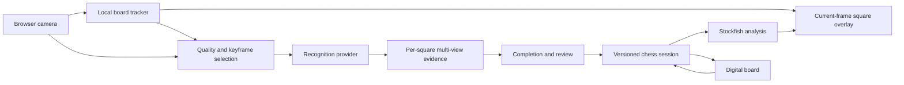

# Guided chessboard scanning and AR: web implementation guide

Research date: 11 October 2026. Status: implementation plan; the features below are
not implemented yet. This is the guide for the next phase after Weeks 1–2.

User requirements: use an iPhone without a Mac; deliver a web prototype that works
across devices. A user moves the camera around a physical board while the application
collects its orientation, all 64 square locations and piece placement. After review,
the application suggests moves through overlays on the camera view and allows
switching to a digital board containing the same position.

## 1. Recommended approach

Build a responsive browser application with a live rear-camera feed, a canvas overlay
and a Python service that initially reuses our trained model and chess engine.
Track the board locally between recognition updates. Combine selected, useful views
into one persistent position estimate. Once measured scan-completion conditions
are satisfied, ask the user to confirm the reconstructed position, then enable
training/puzzle interaction and move overlays.

The foundation is **board-relative camera AR**: square polygons follow the visible
board in the camera image. This achieves the requested source/destination highlights
without requiring native ARKit, a Mac, a headset, depth hardware or WebXR. The
highlights appear on the screen, not as projected light on the wooden board.

Add browser-local ONNX inference after the network-backed prototype works. Keep
WebXR as an optional later adapter on devices where it actually works. Installing
a PWA does not add missing native AR capabilities.

Use progressive milestones. An early assisted scan with corner/orientation input
is useful, but report it separately from the desired automatic, marker-free scan.
The automatic experience remains the final objective.

### Current starting point

Evidence: [Day 12 report](docs/day12_evaluation.md),
[Day 14 report](docs/day14_fen_evaluation.md), and their tracked JSON reports.

| Existing capability | Evidence / limitation |
| --- | --- |
| MobileNetV3 Small, RGB context + target mask | 13 classes; input 4×224×224; checkpoint epoch 16 |
| Prepared test crops | 94.63% overall; 82.68% occupied-square accuracy; 79.68% macro F1 |
| Whole prepared positions | 0/23 exact; 2–7 wrong squares on each |
| Automatic raw-photo processing | 16/30 completed; 12 localization failures, 2 orientation failures; 0 exact positions |
| Geometry and orientation | Reviewed square polygons; camera-view crops; explicit chess-coordinate mappings |
| Outputs | Board matrices, all class probabilities, confidences, placement/full FEN and diagnostics |
| Engine | Existing Python Stockfish wrapper; accepts valid full game state |
| Continuous scanning / web interface | Not implemented |

The existing model is a baseline component, not a reliable completed scanner.
Repeated views may resolve occlusion, but cannot be assumed to correct its systematic
pawn/knight and dark rook/king/queen errors.

## 2. Research findings and decisions

### Browser compatibility determines the AR architecture

Camera access through `navigator.mediaDevices.getUserMedia()` is broadly supported,
requires user permission and a secure context. Prefer the rear camera with an ideal
`facingMode: "environment"`, then inspect the actual track settings. Serve the phone
through trusted HTTPS; `http://<laptop-IP>` is not the phone's localhost exception.
[MDN camera documentation](https://developer.mozilla.org/en-US/docs/Web/API/MediaDevices/getUserMedia)

WebXR availability varies. A WebKit maintainer explicitly stated in March 2026
that WebXR is unsupported on iOS devices; its reported behavior is not a basis for
a shipping iPhone feature. Feature-test on each target rather than promising
immersive AR from an API name. [WebKit issue, maintainer response](https://bugs.webkit.org/show_bug.cgi?id=309550),
[MDN WebXR startup](https://developer.mozilla.org/en-US/docs/Web/API/WebXR_Device_API/Startup_and_shutdown)

**Decision:** a video/canvas camera experience is mandatory; WebXR is optional.
There is no native-iOS build dependency in the core plan.

### A planar board needs projective tracking, not a complete 3D reconstruction

A homography maps coordinates on the flat board to the camera image. It is suitable
for square overlays, while tall piece bodies do not lie on that plane. OpenCV's
homography tutorial describes this distinction. [OpenCV homography](https://docs.opencv.org/4.x/d9/dab/tutorial_homography.html)

Track stable features with pyramidal Lucas–Kanade optical flow and estimate a robust
homography. OpenCV documents both optical flow in JavaScript and feature-based
homography estimation. [OpenCV.js optical flow](https://docs.opencv.org/4.x/db/d7f/tutorial_js_lucas_kanade.html),
[OpenCV feature matching and homography](https://docs.opencv.org/4.x/d1/de0/tutorial_py_feature_homography.html)

**Decision:** establish board geometry once, track it frequently, and re-detect for
recovery. The board must stay visible for dependable overlays. Tracking cannot
promise a persistent world anchor when the board leaves view.

### Optional markers improve bootstrap and measurement

ArUco and AprilTag provide identifiable corners. Their IDs can help break the
checkerboard's repetitive-pattern ambiguity when registered to a board profile.
They still require an explicit relationship between marker locations and a1.
[OpenCV ArUco](https://docs.opencv.org/4.x/d5/dae/tutorial_aruco_detection.html),
[AprilTag official repository](https://github.com/AprilRobotics/apriltag)

**Decision:** support four-corner/manual orientation bootstrap first, and optionally
a removable marker mat for development. Neither is mandatory equipment for the
final product. Do not silently count assisted scans as automatic successes.

### Recognition literature supports testing alternatives, not assuming transfer

ChessCog combines board localization, occupancy and piece classifiers, and studies
adaptation to a different chess set. Its results show the value of set-specific data;
they do not establish accuracy on our wooden set or browser capture stream.
[ChessCog paper](https://arxiv.org/abs/2104.14963)

ChessReD introduced 10,800 real smartphone photographs. Its study found substantial
performance degradation when geometry methods tuned elsewhere encountered real
images, and examined the importance of board markings for orientation. This matches
our need to evaluate geometry and recognition separately.
[End-to-End Chess Recognition](https://arxiv.org/html/2310.04086v2)

A recent alternative, ChessQueries, uses a whole-image encoder and 64 learned
square queries. Its 2026 preprint reports strong exact-board recognition and remaining
occlusion failures. This is a candidate benchmark, not verified performance here.
[ChessQueries paper](https://arxiv.org/html/2608.30762v1)

The author's repository publishes model resources but describes a 304M-parameter
encoder and noncommercial code/weight terms. It is unsuitable as an assumed tiny
browser model or an automatically adopted product dependency. Run any permitted
comparison separately; record latency and terms before considering deployment.
[ChessQueries author repository](https://github.com/JSeytre/chessqueries)

**Decision:** retain MobileNet for the first multi-view experiment. If useful views
still reinforce wrong classes, benchmark one justified alternative: a lightweight
piece detector with base-location prediction, or a board-wide square-query model.
A generic detection box's center or bottom-center is not a reliable piece base.
YOLO alone does not solve orientation, tracking, fusion or scan completion.

### Confidence needs calibration and abstention

Temperature scaling is a practical calibration baseline, fitted on validation data.
It changes probability calibration, not the underlying class ranking or systematic
errors. [On Calibration of Modern Neural Networks](https://arxiv.org/abs/1706.04599)

**Decision:** calibrate and validate completion rules on scan sessions. Do not
multiply successive softmax predictions as if adjacent frames were independent.
Do not fill unobserved/occluded squares with `empty`.

### Browser inference should have a portable CPU path

ONNX Runtime Web documents WebAssembly support across its browser matrix and GPU
providers with differing support. Its documentation notes that WebGL is in
maintenance mode. Use WASM as the portable baseline; probe and benchmark WebGPU
rather than depending on it. [ONNX Runtime Web support](https://onnxruntime.ai/docs/get-started/with-javascript/web.html)

Run heavy work in workers. WASM multithreading requires a compatible cross-origin
isolated deployment; provide a single-thread path when unavailable. Profile actual
phones, including memory and thermal behavior.
[ORT web performance](https://onnxruntime.ai/docs/tutorials/web/performance-diagnosis.html),
[ORT flags](https://onnxruntime.ai/docs/tutorials/web/env-flags-and-session-options.html)

**Decision:** start with server inference; implement ONNX portability as a later
milestone. Export the actual four-channel checkpoint, not a replacement three-channel
ImageNet model. PyTorch's current ONNX documentation describes the exporter workflow.
[PyTorch ONNX export](https://docs.pytorch.org/docs/stable/onnx)

## 3. Product behavior

1. Open the site and choose **Scan a board**.
2. Allow the rear camera. Show the board outline and a short instruction to keep
   the pieces still and retain the borders in view.
3. Establish orientation from readable ranks/files. If unresolved, show a clear
   assisted fallback to identify a1 or White's edge; record that assistance.
4. Move around the board. Show which regions need another view and one useful
   prompt at a time, such as “Move toward the opposite side” or “Hold still.”
5. Accumulate evidence. Confirmed squares may become unresolved again when new
   observations disagree. Progress is evidence coverage, not a probability of truth.
6. When the completion gate passes, show a digital preview for confirmation. Allow
   square-by-square correction and another scan. Separate automatic recognition
   from user-corrected confirmation in metrics.
7. Ask whose turn it is and any game-history information relevant to analysis.
   For a puzzle, allow an explicit puzzle position and solution objective.
8. Offer **Continue on physical board** or **Use digital board**.
9. In physical mode, highlight the source square and destination square of a
   computed move. Keep the overlay aligned as the camera moves.
10. After the player moves, pause stale suggestions, observe the settled position
    and confirm the transition before analyzing again.
11. In digital mode, apply moves to the same session state. Returning to physical
    mode requires checking that the physical board matches that state.

The initial interaction can require confirmation. The final goal is a mostly
automatic scan with clear recovery, not endless scanning until confidence happens
to rise. A timeout offers review/rescan rather than a fabricated success.

## 4. System architecture



### Recommended components

| Component | Initial implementation | Later option |
| --- | --- | --- |
| UI | React + TypeScript + Vite, responsive CSS | Installable PWA |
| Camera | HTML video + getUserMedia + frame callbacks | Optional platform-specific adapters |
| Overlay | Canvas 2D with current square polygons | WebGL/Three.js only if needed |
| Local tracking | OpenCV.js/WASM worker, optical flow + RANSAC | Learned keypoints / verified marker detector |
| Recognition | Existing Python PieceClassifier through a small FastAPI service | ONNX Runtime Web worker |
| Evidence and completion | Deterministic Python reference implementation | Matching TypeScript or shared WASM implementation |
| Chess state | Server python-chess authority; frontend renders canonical state | chess.js for validated local/offline operations |
| Engine | Existing Stockfish wrapper in a bounded background worker | Browser WASM engine after profiling |
| Development access | Trusted HTTPS to laptop-hosted service | Hosted HTTPS prototype |

Vite supplies the frontend development/build workflow, and FastAPI supports
WebSocket transport. A browser camera page needs no Mac. A server-backed prototype
needs connectivity to the Python service; it is not yet an offline application.
[Vite guide](https://vite.dev/guide/), [FastAPI WebSockets](https://fastapi.tiangolo.com/advanced/websockets/)

chess.js supports browser move generation/validation, not engine strength or computer
vision. Keep a single state authority and contract tests if it is used alongside
python-chess. [chess.js project](https://github.com/jhlywa/chess.js)

Do not have every video frame call the slow raw-photo detector. Three loops operate
independently: camera rendering, geometry tracking, and selected-frame recognition.
A slow recognition response must not delay the live view or place an old polygon
onto the current video.

## 5. Geometry and orientation contract

### Permanent board coordinates

Use a board plane measured from the a1 outer playing-area corner toward h1 and a8:

- Origin `(0, 0)` at the a1 corner, with a1 occupying `[0,4] × [0,4]` cm.
- X increases toward file h; Y increases toward rank 8.
- Playing area is 32×32 cm; square size is 4 cm.
- Outer board extends from −3.5 to 35.5 cm on both axes: 39×39 cm total.
- Square center for zero-based file `f`, rank index `r`: `(4f+2, 4r+2)` cm.

Maintain `H_board_to_frame` for each captured frame and its inverse. Projection is
`[u,v,1] ∝ H [x,y,1]`. Assign square identity in board coordinates; never reassign
it because the user walks around. Homography and square-polygon residuals belong
to a versioned geometry estimate. A large fit discrepancy triggers re-localization. Preserve the reviewed 81 grid
intersections/64 square polygons as a board-plane mesh when available; propagate
that mesh through tracking and refine it from image evidence. Do not regress to
fitting the whole outer board into a fixed playing-area crop.

Four corner orders anchored to image “top-left” are only a detector representation.
After semantic orientation is established, maintain canonical vertex identities
instead of sorting them again on every frame. Test arbitrary continuous rotations,
not just 0°, 90°, 180° and 270°.

Existing quarter-turn mappings remain correct at their camera-view conventions:
White bottom → image TL a8; White top → TL h1; White left → TL a1; White right →
TL h8. The browser tracker uses the continuous transform instead of repeatedly
rotating image pixels to White-bottom.

### Camera and display coordinates

Track in intrinsic video pixels using actual `videoWidth` and `videoHeight`.
Define separate transforms for inference resizing, worker tracking resolution and
CSS display. Account for object-fit cropping, letterboxing, device-pixel ratio,
portrait/landscape changes and any mirrored preview. Rear video should ordinarily
be unmirrored. Round-trip projected coordinates in tests.

Keep capture frame IDs and timestamps. Geometry from a server response belongs to
its capture frame. Fuse semantic evidence in board coordinates and render it through
the latest local transform. Reject stale geometry and incompatible board versions.
Use video frame callbacks where available, with a guarded animation-frame fallback.
[MDN frame callbacks](https://developer.mozilla.org/en-US/docs/Web/API/HTMLVideoElement/requestVideoFrameCallback)

### What browser geometry does not provide automatically

Normal browser video does not guarantee camera intrinsics, LiDAR depth or an ARKit
pose. Accurate metric 3D pose needs calibration/intrinsics; PnP explicitly requires
these. Do not infer exact camera angles or claim 6-DoF world tracking from an
uncalibrated homography. [OpenCV PnP](https://docs.opencv.org/4.x/d5/d1f/calib3d_solvePnP.html)

For the prototype, use relative view-change features from homographies and image
appearance as diversity proxies. Optional camera calibration permits proper pose
bins later. Rotating the phone in place or digitally cropping one image is not a
new view that exposes an occluded piece.

## 6. Session and message contracts

Implement versioned, validated schemas before network integration. Proposed fields:

| Record | Required information |
| --- | --- |
| BoardProfile | board ID, 32 cm playing size, 4 cm squares, borders, marking profile; optional marker layout/calibration |
| FrameObservation | session ID, frame ID, capture timestamp, board epoch, orientation/geometry version, source and processing dimensions, H, quality values, source hash if persisted |
| SquareObservation | canonical square, 13 logits/probabilities, crop/mask provenance, base visibility or unknown, body visibility or unknown, view group, evidence weight, rejection reasons |
| SquareEvidence | distributions by useful view group, label candidate, disagreement, supporting observations, last valid time, resolution status |
| ScanSnapshot | unresolved squares, evidence coverage, orientation status, gate results, automatic/assisted/user-corrected provenance |
| PositionSnapshot | immutable position version, placement, explicit full-FEN fields, validation, square confidence/evidence, physical confirmation state |
| AnalysisResult | position version/hash, engine settings/version, UCI move including promotion, score/line, terminal-position status |
| MoveObservation | before version, candidate move, board-change evidence, hand/settling status, commit result or ambiguity |

Resolution states: `unobserved`, `collecting`, `conflicted`, `resolved`,
`user_confirmed`. Tracking states: `uninitialized`, `tracking`, `degraded`, `lost`.
A resolved square is evidence-backed, not guaranteed correct.

Use one in-flight recognition request per session initially and a bounded latest-frame
buffer. Correlate response IDs and discard responses from old epochs after a
rescan, board movement, position change or orientation correction. Browser timestamps
are relative clocks; calculate network latency with local send/receive timings
rather than subtracting unrelated client/server clocks.

The API can begin with session creation, keyframe submission, scan-state retrieval,
confirmation, analysis and session deletion. Add WebSocket transport for binary
keyframes and state events once the protocol is tested. Track `bufferedAmount`,
apply backpressure and drop redundant unsent frames. Do not base64-encode an
unbounded video stream. [MDN bufferedAmount](https://developer.mozilla.org/en-US/docs/Web/API/WebSocket/bufferedAmount)

## 7. Multi-view recognition and completion algorithm

### Observation acceptance

Accept a frame only when localization/tracking, scale, sharpness, exposure and
source coverage meet configured bounds. Mask hands and reject touched/moving
regions. Begin with conservative whole-frame suspension while a hand obscures
the board, then refine to per-square exclusion when that is validated.

Use visibility labels/proxies separately from classifier confidence. For example,
an occluded base cannot be established from the model calling a crop “empty.”
Start with explicit `visibility_unknown` and conservatively selected views; train
or evaluate a visibility estimator if it becomes necessary for automatic completion.

Classify the same context + target-mask representation initially. Quality improvements
must preserve the model contract. Homography aligns the board plane and cannot
straighten 3D pieces. A raw-view or geometry-conditioned crop alternative needs
its own training/evaluation; do not quietly substitute it at inference.

### Evidence fusion

Maintain a small set of high-quality observations for each square, grouped by
meaningfully different views. Cap one group's influence; replace redundant frames
with better examples rather than counting thousands of copies.

Start with a weighted arithmetic mean of calibrated class probabilities:

`P(square, class) = sum(weight * probability) / sum(weight)`

Weights reflect geometry, scale, sharpness, visibility and view novelty. Fit rules
using development/validation sessions; they are initially heuristic, not proven
probabilistic independence. Retain per-view predictions and disagreements. Compare
single best frame, unweighted averaging and capped weighted fusion as ablations.

A persistent disagreement or insufficient class separation requests another view
or user review. High confidence from one direction cannot overrule every other
view. Calibration/averaging cannot repair confidently wrong features by themselves.

### Completion gate

Proposed starting rule, to tune and validate rather than present as an accuracy claim:

- Semantic orientation is established with no unresolved conflict.
- Geometry is tracked, nonfolded and consistent with board dimensions/visible grid.
- Every square has enough acceptable observations, including empty squares.
- Each occupied or uncertain square has support from at least two meaningfully
  distinct accepted view groups; require more when disagreement remains.
- Per-square calibrated score/margin and disagreement checks pass validation-tuned
  thresholds. Thresholds must consider rare classes, not only empty squares.
- No hand, piece change or geometry change has invalidated that evidence.
- The final position has remained stable for a short settling interval.
- Diagnostics and user review are available; unresolved problems prevent automatic
  completion, while composed-position mode can explicitly retain chess diagnostics.

Use a bounded session timer. On failure, offer targeted rescan or correction.
If pieces move during the scan, create a new board epoch or invalidate affected
observations; never merge two positions. Orientation corrections remap/invalidate
prior evidence explicitly.

Show separate progress for geometry/orientation and resolved square coverage.
`64/64 resolved` is a completion condition, not “100% accurate.” Do not translate
softmax means into the probability that the whole board is correct.

## 8. Data collection and evaluation protocol

### What the user needs to provide

No Mac is required. Development starts with the existing photos and replay fixtures.
Before claiming automatic guided recognition, collect short continuous camera scans
and known positions. A second Android phone or borrowing one is needed for a real
cross-device validation; desktop emulation cannot establish phone camera performance.

**Pilot:** 12 positions × 2 scans = 24 sessions, roughly 15–30 seconds per scan.
Use existing positions for engineering/replay if convenient and label them as
previously seen. Include overhead → moderate oblique → opposite-side views, then
return toward the start. Keep pieces fixed. Do not require unsafe low angles or a
full circle if a few suitable views already resolve the board.

Cover crowded openings/middlegames, sparse endgames, dark pieces on brown squares,
edge pieces, pawn/knight confusions, promotions and composed positions. Include
indoor rooms and even outdoor light. Separate stress scans contain hands,
intentional motion blur, temporary board loss, orientation changes and board/piece
movement; label change timestamps and expected recovery.

**Fresh modeling pilot:** collect 30 new positions × 2 scans = 60 sessions after
pilot tooling works. Split by position into 18 training, 6 validation and 6 locked
test positions. Group duplicate placements, same games/near-identical setups and
all sessions/frames from a position. The 12-session final subset is an engineering
pilot, not sufficient evidence for a strong low-error product claim. Expand final
coverage before release, especially across different equipment.

The old three test positions are now development evidence, not an untouched final
benchmark. Reserve new final positions before viewing model results. Record manual
assistance, markers and corrections independently.

### Labels and recording format

Save session ID, position ID, placement FEN, explicit game fields, equipment/profile,
lighting, date, capture device/browser/version, dimensions, view steps, changes and
split. Record selected full-resolution unannotated frames, timestamps, current
geometry and acceptance decisions. Video is useful but selected image sequences
are sufficient for deterministic replay and avoid codec dependence.

Retain expected ground-truth labels for squares even when hidden; mark observation
visibility separately as base visible/partial/hidden/unknown and body visible/partial/
hidden/unknown. Annotate a representative subset of occupied pieces for body boxes
and base contact points/polygons if training detection/visibility. FEN alone supplies
class placement, not a visible body box or precise base location.

Verify a1 and several asymmetric occupied squares visually. Source hashes invalidate
stale geometry/labels. Leave the present 180-photo dataset and split unchanged.
For video capture, probe recorder formats and fall back to frame sequences rather
than assuming one codec works on every device.
[MDN recorder format probing](https://developer.mozilla.org/en-US/docs/Web/API/MediaRecorder/isTypeSupported_static)

### Metrics

Report: automatic and assisted exact-placement accuracy; occupied-square and
all-square accuracy; orientation errors; geometry reprojection error; scan completion
rate; time to completion; false completion rate; abstentions; user corrections per
scan; tracking loss/recovery; overlay error normalized by square width; move-transition
accuracy; stale suggestion incidents; phone latency, memory and battery/thermal data.

Include failed/timed-out sessions in all-attempt denominators. Report accuracy among
automatically completed scans alongside how often the system completes. Report
user-confirmed/corrected outcomes separately. Aggregate by position/session, never
claim independent samples by counting correlated video frames.

Proposed prototype goals, not achieved results:

| Gate | Initial target |
| --- | --- |
| Camera and overlays | Working iPhone Safari, Android Chrome and desktop replay |
| Tracking | At least 15 updates/s on reference phones; hide unreliable overlays promptly |
| Overlay alignment | Median error < 0.1 square width; p95 < 0.2 on labeled visible frames |
| Recovery | Reacquire within 2 seconds after a short loss on the agreed test cases |
| Recognition response | p95 < 2 seconds per selected frame on prototype network; adaptive scheduling |
| Guided scan | ≥90% of in-scope sessions complete automatically within 30 seconds |
| Exact automatic completions | ≥95% exact on locked in-scope sessions, with coverage and uncertainty reported |
| Incorrect automatic completion | Later reliability target ≤1% of automatic completions (i.e. ≥99% exact); requires a larger sample |
| Move overlays | Zero stale-version move displays in fault-injection tests |
| Digital ↔ physical | No silent application of unobserved physical changes |

The 95% exact-completion gate is an initial prototype milestone; the ≤1% false-
completion target is a stricter later reliability milestone, not an equivalent
threshold. Define false completion as an automatically completed scan whose
placement is wrong. Report its denominator as all automatic completions.
These recognition targets are intentionally stronger than square-level scores.
Estimate uncertainty by session/position, e.g. position-group bootstrap. A small
sample with zero false completions cannot prove a 1% failure bound; expand the
holdout and report confidence intervals before making that claim. If a gate fails,
retain assisted/review mode and improve the measured bottleneck.

## 9. Step-by-step implementation tasks

Complete each step's checks before declaring it done. A later UI demo can use
explicit synthetic fixtures while recognition is being improved, but must be
labeled as such and must not imply that an unmet accuracy gate has passed.

Initial implementation: [camera/alignment prototype](docs/guided_scan_prototype.md).
Steps 01–02 are in progress; phone acceptance and the remaining contracts are pending.

### Step 01 — Freeze the baseline and define scan contracts

**Goal:** protect working Week 2 results and establish one coordinate/state contract.

- [x] Record model checksum, label version, preprocessing contract and Day 14 metrics.
- [ ] Define BoardProfile, observations, scan/position versions and resolution states.
- [ ] Implement continuous board-to-frame coordinate transforms and conversions.
- [ ] Define automatic, assisted, marker-assisted and corrected session categories.
- [ ] Add configuration for quality/fusion/completion settings; version these separately
  from model weights and data.
- [ ] Create golden fixtures from existing boards in all four orientations and arbitrary
  rotations, with expected a1/h8 mappings.

**Deliverables:** schemas, scan config, coordinate tests and baseline manifest.
**Acceptance:** no orientation ambiguity in coordinate tests; no Week 2 data/model changes.
**User input:** none.

### Step 02 — Build the browser camera and overlay shell

**Goal:** prove the cross-device experience before adding recognition complexity.

- [x] Create `web/` with React/TypeScript/Vite; keep the Python repository intact.
- [ ] Implement camera start/stop, permission errors, rear-camera preference and device
  selection where supported; use `playsinline` and a user-triggered start.
- [ ] Establish trusted HTTPS access from the iPhone to the development machine.
- [ ] Render video plus canvas with tested video→display transforms.
- [x] Show a fixture-based 8×8 board overlay and tap-to-select squares.
- [ ] Handle orientation/viewport changes, camera disconnect, page backgrounding and resume.
- [ ] Add frame-ID scheduling with video callbacks and fallback; use workers for heavy work.
- [ ] Feature-test camera, workers, WASM and optional GPU/XR capabilities; log browser versions.

**Deliverables:** camera page, capability report and display-transform tests.
**Acceptance:** camera works on the actual iPhone; overlay matches a manually selected
quad in portrait/landscape; stopping releases the stream.
**User input:** on-device camera permission and a short manual test; no Mac needed.

### Step 03 — Build the capture/replay harness

Image-sequence capture/export and deterministic validation/geometry replay are
implemented: [usage](docs/guided_scan_capture.md). Recognition replay and pilot
collection remain pending; this step has not passed on-device export acceptance.

**Goal:** make every scanning failure reproducible.

- [x] Implement session recording of selected frames, timestamps and geometry/events.
- [ ] Add optional video recording with runtime format detection and image-sequence fallback.
- [x] Export a session ZIP/manifest and ground-truth position form.
- [ ] Write deterministic replay through tracking, recognition and scan logic.
- [ ] Record blur, coverage, hand events, board changes, rejected frames and assistance.
- [ ] Collect the 24-session pilot; reserve fresh position groups for later evaluation.

**Deliverables:** recorder, session schema, replay CLI and pilot dataset.
**Acceptance:** one exported session reproduces the same evidence decisions; duplicate
frames cannot increase independent-view counts.
**User input:** pilot scan sequences and their positions/FENs when this tool is ready.

### Step 04 — Establish geometry and semantic orientation

Initial still-frame automatic proposals and assisted image-supported refinement
are implemented: [results and phone instructions](docs/guided_scan_bootstrap.md).
A [trained board-font marking reader](docs/learned_board_markings.md) now improves
the sampled automatic candidate count from 2/11 to 4/11. Robust all-side acceptance
and tracking have not been achieved.

**Goal:** bootstrap a correctly identified board from a live camera frame.

- [x] Reuse classical detection as one candidate source; evaluate it on pilot frames.
- [ ] Add explicit four-corner bootstrap and a1/White-edge confirmation fallback.
- [ ] Replace fragile template-only assumptions with tested marking recognition for
  this board; preserve an `uncertain` result when labels cannot be read.
- [ ] Validate checker parity, border/grid alignment and semantic corner identity.
- [ ] Reuse image-supported grid fitting to refine each square polygon; retain the
  39 cm outer board and context instead of clipping the 32 cm grid to an arbitrary
  fixed canvas. Compare inferred occluded boundaries with visible evidence.
- [ ] Add optional marker-layout profile and detector experiment if bootstrap needs
  a reliable reference. Verify browser WASM bindings rather than assuming ArUco
  ships in every OpenCV.js build.
- [ ] If using markers, generate a removable mat outside the 39 cm board or a measured
  border layout; preserve original labels and measure marker-to-grid coordinates.
- [ ] Register optional markers to a1 explicitly and distinguish inferred vs supplied
  orientation. Never derive orientation from current piece arrangement alone.
- [ ] Save initialized canonical geometry, diagnostic overlay and provenance.

**Deliverables:** bootstrap module and orientation/geometry evaluation report.
**Acceptance:** correct square IDs from every camera side; mirrored, ambiguous and
incorrect-border cases are rejected or routed to assistance.
**User input:** identify a1 in assisted tests; optional printed markers only if that
experiment is chosen. No mandatory permanent modification to the board.

### Step 05 — Implement fast board tracking and recovery

**Goal:** keep square overlays attached as the camera moves.

- [ ] Track border/grid-plane features in a WASM worker; avoid piece tops and hands.
- [ ] Fit robust homographies with forward/backward tracking checks, spatially distributed
  inliers and projection residual tests. Do not rely on inlier count alone.
- [ ] Replenish features, re-detect periodically and compare against stable anchors.
- [ ] Handle checkerboard repetitive patterns, arbitrary roll and full viewpoint changes;
  suppress frame-to-frame semantic quarter-turn flips.
- [ ] Add tracking-quality states and smooth projected corners only within a latency budget.
- [ ] Hide overlays when geometry is lost, stale or folded; reacquire with orientation validation.
- [ ] Detect board displacement/profile change and start a new geometry/evidence epoch.
- [ ] Release WASM matrices, image buffers and worker resources; test long-session memory.

**Deliverables:** local tracker, recovery behavior and tracking replay report.
**Acceptance:** meet measured alignment/update-rate goals; no overlays stuck to an old
board location after tracking loss; a1 remains a1 throughout a walk around the board.
**User input:** short camera-motion and board-loss tests.

### Step 06 — Connect selected-frame recognition

**Goal:** reuse the existing model without blocking the live view.

- [ ] Add a small FastAPI service loading one classifier per bounded inference worker.
- [ ] Create session/keyframe endpoints and model/preprocessing version metadata.
- [ ] Send selected images and same-frame geometry, not a continuous full-rate stream.
- [ ] Validate dimensions, IDs, transforms, payload limits and timestamps.
- [ ] Reuse polygon context extraction and RGB+mask preprocessing; preserve pixel
  appearance relative to camera rather than forcing White-bottom pixels.
- [ ] Verify server/client scale transforms and the full-board context margin.
- [ ] Return all 13 logits/probabilities, canonical square IDs and crop/coverage diagnostics.
- [ ] Add latest-frame backpressure, timeouts, cancellation and stale-response rejection.
- [ ] Ensure CPU inference runs off the network event loop; measure shared-load behavior.
- [ ] Test JPEG capture/compression against the existing lossless reference; select
  quality/resolution that preserves recognition rather than maximizing upload rate.

**Deliverables:** network recognition provider and parity/latency report.
**Acceptance:** golden crops match the Week 2 classifier outputs; UI remains responsive
under deliberately slow responses; old-session observations never enter a new scan.
**User input:** phone and server on a reachable network; no new labels for parity tests.

### Step 07 — Improve recognition where pilot evidence justifies it

**Goal:** reduce persistent piece errors before completion logic hides them.

- [ ] Compare single-frame and multi-view baseline behavior on pilot scans.
- [ ] Review recurring targets/bases and labels against raw frames; separate label errors,
  geometry errors, invisibility and model confusions before changing anything.
- [ ] Build the fresh-position split and add realistic capture-domain training examples.
- [ ] Fine-tune the existing classifier with one change per experiment, selected by validation
  exact-position/occupied-square metrics as well as per-class scores.
- [ ] Fit temperature scaling on validation observations; preserve logits and calibration version.
- [ ] If confident errors persist, benchmark one alternative, not several simultaneous rewrites.
- [ ] For a detector, annotate full bodies plus base contact locations and visibility;
  assign squares using base-plane geometry, not body-box center.
- [ ] For a square-query experiment, review code/weight/data terms, hardware requirements,
  deployment size and independent performance before adoption.
- [ ] Keep inference-provider interfaces stable; retain the old checkpoint and reports.

**Deliverables:** failure taxonomy, updated candidate/calibration reports or documented
reason to retain the baseline.
**Acceptance:** improvement verified on validation and independent sessions; no claim
that repeated frames alone guarantee correctness; final test remains locked.
**User input:** fresh scans/positions and selective body/base annotations if required.

### Step 08 — Add quality, visibility and view-diversity selection

**Goal:** accumulate informative observations, not redundant uncertain frames.

- [ ] Add normalized sharpness, exposure, square scale and source-coverage tests.
- [ ] Detect or conservatively gate hands/motion; label visibility as unknown until supported.
- [ ] Group related observations by relative homography/image changes and sequence segment.
- [ ] Validate that viewpoint groups reflect actual body visibility changes; screen rotation
  and rescaling alone must not count as distinct views.
- [ ] Keep best evidence per group/square; cap evidence count and contribution.
- [ ] Score unresolved regions to choose the next prompt; stop requesting already redundant views.
- [ ] Request calibrated pose only if coarse view-diversity proxies demonstrably fail.

**Deliverables:** keyframe selector, visibility/quality report and prompt-selection inputs.
**Acceptance:** dark/blurred/hand-covered frames cannot resolve squares; duplicates cannot
saturate completion; an opposite-side view can contribute new evidence.
**User input:** stress scans with known obstructions and movement intervals.

### Step 09 — Implement evidence fusion and completion

**Goal:** obtain a stable, inspectable scan result with explicit abstention.

- [ ] Implement per-square capped weighted pooling and persistent conflict history.
- [ ] Run best-frame, simple-average and quality/diversity fusion ablations.
- [ ] Define validated support, margin, disagreement and stability thresholds.
- [ ] Apply completion checks to all 64 squares and orientation/geometry together.
- [ ] Add timeout, targeted rescan and user correction; preserve correction provenance.
- [ ] Invalidate evidence on moves, geometry-epoch changes and orientation corrections.
- [ ] Implement the session state machine: camera ready → locating → scanning → review →
  confirmed, with paused/lost/recovery paths and cancel/reset.
- [ ] Evaluate false completion, completion coverage and exact placements per session.

**Deliverables:** scanner controller, completion report and UI status contract.
**Acceptance:** intentionally obscured squares remain unresolved; changing a piece does
not produce a mixed position; high-confidence conflicting evidence cannot silently
force completion. If exact-position goals fail, keep the review-required prototype.
**User input:** confirmation/correction tests; ground-truth scans for gate evaluation.

### Step 10 — Finish the guided capture and review experience

**Goal:** deliver the FaceID-like interaction without implying perfect accuracy.

- [ ] Show live board alignment, unresolved regions, useful viewpoint prompts and evidence progress.
- [ ] Use one actionable prompt at a time; support text/icons, not color alone.
- [ ] Show a complete digital preview on gate completion, with tap-to-correct pieces and orientation.
- [ ] Distinguish automatic scan completion from explicit user confirmation.
- [ ] Add sensible behavior for network loss, permissions, page backgrounding and resuming.
- [ ] Handle camera stream teardown/restart, relocalization and validation of saved state.
- [ ] Persist confirmed position/settings locally; do not cache stale geometry as current tracking.

**Deliverables:** guided scanning page and review/edit workflow.
**Acceptance:** a user can complete, correct, cancel and resume a scan without interpreting
engineering diagnostics; unresolved scans have a clear recovery path.
**User input:** short usability pass on the iPhone and another target device.

Page visibility is observable and should pause ongoing work when hidden; resume
requires tracking validation. [MDN page visibility](https://developer.mozilla.org/en-US/docs/Web/API/Document/visibilitychange_event)

### Step 11 — Connect chess analysis and physical-board overlays

**Goal:** highlight a useful legal move on the tracked board.

- [ ] Confirm side to move and explicitly handle castling/en-passant/history inputs.
- [ ] Reuse position diagnostics; allow export/review of composed positions, but do not
  call the current engine wrapper on a position it rejects as invalid.
- [ ] Run Stockfish in a bounded background job with cancellation and position-version IDs.
- [ ] Handle checkmate/stalemate/no move, promotion, engine errors and analysis time limits.
- [ ] Render source and destination polygons using the newest valid tracking transform.
- [ ] Add contrasting colors, outlines and an optional arrow; keep the physical piece visible.
- [ ] Suppress analysis results whose position hash/version is stale.
- [ ] Hide move overlays while tracking is unreliable or a hand/piece transition is in progress.
- [ ] Test orientation through 360° and track loss during analysis.

**Deliverables:** engine API, version-safe overlay renderer and physical suggestion demo.
**Acceptance:** source/destination remain on the intended squares as the user moves;
no outdated move is shown after a committed position change.
**User input:** side to move and relevant game history for real test positions.

Initially, no full piece mesh or depth-aware rendering is necessary. A source-square
highlight identifies the piece. True occlusion-aware 3D rendering is a later option.

### Step 12 — Synchronize physical moves and the digital board

**Goal:** support play/puzzles beyond a single static recommendation.

- [ ] Maintain one versioned chess session, with a separately tracked physical placement
  checkpoint and any digital moves not yet reproduced physically.
- [ ] Pause observations during hand contact, wait for settling and recognize changed regions.
- [ ] Generate legal transition candidates from the confirmed state and compare visual evidence;
  request confirmation when candidates remain ambiguous rather than inventing a move.
- [ ] Support ordinary moves, captures, castling, en passant and promotion choice.
- [ ] Support undo, board reset, multiple pieces moved, illegal arrangements and puzzle setup edits
  through explicit rescan/edit paths.
- [ ] Recompute game state only after an accepted transition; cancel obsolete engine work.
- [ ] Render a digital board from the same confirmed state with legal move interaction.
- [ ] On physical→digital switching, preserve turn/history. On digital→physical switching,
  verify the physical placement or show the moves needed to synchronize it.
- [ ] Add puzzle definition/import, goal/solution line, hints and success checks. Engine
  “best move” and a particular puzzle's supplied solution are different contracts.

**Deliverables:** move-state manager, digital board, switch/synchronization flow and puzzle demo.
**Acceptance:** special moves and rapid mode switching retain one coherent game state;
physical/digital divergence cannot be silently accepted.
**User input:** representative special-move/puzzle sessions and solution data when available.

### Step 13 — Add portable browser-local inference and offline options

**Goal:** reduce network dependence where actual devices can support it.

- [ ] Export the four-channel trained candidate to ONNX with declared input/output shapes,
  canonical labels and preprocessing metadata.
- [ ] Compare PyTorch and ONNX outputs on golden inputs before browser integration.
- [ ] Implement exact RGB channel order, per-channel normalization, resizing and target-mask
  rasterization in a worker. Measure parity, including boundary pixels/interpolation.
- [ ] Benchmark WASM batch sizes on iPhone Safari and Android; infer unresolved/changed squares
  when appropriate rather than forcing all 64 at video frame rate.
- [ ] Enable supported WebGPU only after a real inference test; keep WASM/server fallback.
- [ ] Add deployment isolation headers only when worker/multithread measurements justify them;
  test asset loading and maintain single-thread fallback.
- [ ] Compare accuracy before/after quantization or reduced input sizes; never trade away rare
  piece accuracy without reporting it.
- [ ] Cache versioned app/model assets with an explicit update strategy; measure storage/load limits.
- [ ] If offline play is required, add a profiled browser engine and validated local chess-state
  path. A cached UI with server analysis is not fully offline.

**Deliverables:** model parity report, on-phone benchmarks and optional local provider.
**Acceptance:** selected local inference passes accuracy/parity checks and remains responsive;
server mode still works when local acceleration fails.
**User input:** on-device timing/thermal tests; no Mac requirement.

### Step 14 — Validate cross-device reliability and release the prototype

**Goal:** prove the requested experience on independent sessions and document boundaries.

- [ ] Run locked fresh-position scans after freezing model, fusion, thresholds and UI behavior.
- [ ] Include failure/timeout denominators, assistance rates, exact boards and occupied-square metrics.
- [ ] Test iPhone Safari, Android Chrome and desktop replay; log actual OS/browser versions.
- [ ] Test low light, outdoors/glare, crowded boards, edge pieces, camera roll, temporary loss,
  board movement, hands, network delay/disconnect, backgrounding and camera restart.
- [ ] Run sustained sessions for memory leaks, overheating, battery impact and latency drift.
- [ ] Measure overlay alignment from independent corner/line annotations, not self-reprojection only.
- [ ] Test stale engine results, concurrent sessions and mode-switch races.
- [ ] Review device capability probes, dependencies, model/data terms and asset notices.
- [ ] Verify explicit recording opt-in, frame retention/deletion, camera teardown and
  concurrent-session isolation under the operating behavior in Section 10.
- [ ] Package trusted HTTPS hosting, development/run instructions, model versions and recovery flows.
- [ ] Record unresolved limits honestly; do not call a review-assisted scanner fully automatic.

**Deliverables:** acceptance report, runnable web prototype, usage guide and release checklist.
**Acceptance:** product/measurement gates from Section 8 pass on actual devices, or the
prototype is explicitly released with measured limits and assistance requirements.
**User input:** final independent scans and real-device acceptance runs.

Stockfish distribution uses GPLv3 terms; if distributing a browser engine binary,
include its applicable notices and corresponding source information. This affects
the offline packaging task, not camera scanning. [Stockfish project licensing](https://stockfishchess.org/about/)

## 10. Deployment, retention and operating behavior

Start with one trusted HTTPS origin serving the frontend and proxying the Python API,
so the camera page, model assets and session endpoints have a clear deployment path.
Self-signed certificates require a trusted device setup; an insecure LAN URL alone
is insufficient. Record setup instructions for the chosen development endpoint.
Pin packages/toolchains after a compatibility spike and store model/data checksums.

Keep camera preview and tracking local. Clearly indicate when selected frames are
sent to the service. Default inference sessions should not retain images after
processing; opt-in development recording stores them with a configurable expiry
and deletion action. Dataset contributions require a separate explicit opt-in.
Store confirmed chess state separately from imagery. Bound frame dimensions,
request sizes, session lifetime and worker queues; isolate concurrent sessions.
The initial service can live on the existing Linux machine, with no public deployment
required for development. A hosted or local trusted endpoint is an implementation
choice, not a completed action in this plan.

Add transport-origin/session checks, cancellation and cleanup as part of API work.
No camera data should be placed in normal request logs. Backgrounding stops capture
and analysis, while restarting revalidates tracking. Service-worker caching must not
replay old API state or retain capture images by accident. Camera switching or
resolution changes invalidate coordinate transforms and any optional calibration.

For optional WebXR, implement a separate capability-tested adapter only after the
baseline scanner works. Session support alone is insufficient: verify usable camera
frames, coordinate correspondence and required features on the actual device.
Keep the camera/canvas mode available. A WebXR polyfill is not a substitute for
missing device tracking or camera access. Full VR/headset support is outside the
first browser prototype; it can later consume the same confirmed chess session.

## 11. Proposed repository additions

Preserve current modules; add components when their milestone starts, not all at once.

```text
config/scanning.yaml
src/scanning/
  contracts.py          # observations, state/version schemas
  geometry.py           # board coordinates and projection
  quality.py            # quality/visibility decisions
  keyframes.py          # novelty and bounded selection
  fusion.py             # evidence aggregation
  completion.py         # calibrated gate and abstention
  session.py            # scanning state machine
  moves.py              # physical transitions and synchronization
src/api/
  app.py                # FastAPI lifecycle and routes
  sessions.py           # bounded session/worker access
web/
  src/camera/           # camera lifecycle and display transforms
  src/tracking/         # WASM worker and board tracking
  src/scanning/         # guided UX and provider contracts
  src/chess/            # digital board and session rendering
  src/overlays/         # projected square rendering
  src/workers/          # recognition/engine adapters when needed
scripts/
  replay_scan.py
  evaluate_scans.py
  export_classifier_onnx.py
  benchmark_browser_model.py
  evaluate_tracking.py
data/metadata/scans/    # compact manifests/splits/review records
outputs/scanning/      # generated replay/evaluation artifacts
models/exported/       # versioned deployment model, normally ignored if large
```

Reuse `src/vision/inference.py`, `dataset_loader.py`, `grid_geometry.py`,
`position_pipeline.py`, `orientation.py`, `src/chess/fen.py`, `validation.py` and
`engine.py`. Expand CLI/service boundaries rather than copying algorithms into routes.
Keep new capture files and large generated outputs out of Git; retain compact manifests,
hashes, settings and reports. Cross-language contracts need golden fixture tests.

## 12. First implementation slice

Start with Steps 01–02: contracts, a live rear-camera page and a correctly projected
fixture/manual quad on the iPhone. Then build recording/replay before model changes.
This immediately tests browser access, coordinate alignment and usability without
mistaking recognition accuracy for overlay success.

Next, initialize and track geometry, connect the unchanged model, collect pilot scans
and measure whether multiple viewpoints actually improve exact positions. That
measurement determines the scope of Step 07's recognition work. Do not spend the
first implementation phase training a new architecture or building immersive VR.

Open research questions are tracked explicitly: marker-free initialization success,
marking visibility across viewpoints, source of persistent piece confusions,
visibility estimation reliability, on-phone WASM budget and achievable false-completion
rate. Resolve them through the relevant milestone's data and acceptance report.

## 13. Definition of done

- [ ] The site opens on the iPhone without a native app or Mac.
- [ ] Live video and board-relative overlays remain usable on validated devices.
- [ ] Board orientation and square identity remain stable as the camera moves.
- [ ] All 64 squares gather inspectable, quality-controlled evidence.
- [ ] Guided scanning completes or clearly abstains; progress is not advertised as accuracy.
- [ ] Independent exact-position and false-completion metrics meet the agreed scope.
- [ ] The user can review/correct and confirm the reconstructed position.
- [ ] Explicit game state enables version-safe engine analysis.
- [ ] Source/destination overlays follow the board and disappear when unreliable/stale.
- [ ] Physical moves and special moves update state only after validated transitions.
- [ ] Digital/physical switching preserves state and detects divergence.
- [ ] Puzzle goals, hints and move analysis are supported with explicit solution semantics.
- [ ] Recovery, device performance and privacy/retention behavior are tested/documented.
- [ ] Deployment, model/data terms, versions and limitations are documented.

No 100% recognition guarantee is part of the definition. Completion, confirmation,
automatic exact recognition and user-corrected success are measured separately.
